# 📡 Solución RFID Industrial Multi-Agente End-to-End
### Sensormatic IDX-4000 + Bindu Edge Node + Google CEL + Semantic AI Reactor (Ollama i18n) + WhatsApp BPR

---

## 🌐 1. Arquitectura del Sistema (Visión Global)

Esta solución despliega una canalización ciberfísica e industrial de **Internet de las Cosas (IoT), Sistemas Multi-Agente (MAS) e Inteligencia Artificial en el Borde (Edge & Cognitive AI)** gobernada integralmente por **Bindu**.

Su objetivo es detectar en tiempo real cuándo un activo físico con tag RFID EPC SGTIN-96 es posado directamente sobre una antena de campo cercano Keonn Advan-CP1, evaluar deterministamente su cinemática de proximidad, traducir cognitivamente la alerta al idioma nativo del destinatario mediante un modelo SLM local (Ollama) y despacharla de forma segura y controlada (anti-spam) a través de WhatsApp.

```mermaid
flowchart TB
    %% ========================================================
    %% FILA 1: CAPTURA FÍSICA Y NODO EDGE (idx4000-00-50-f9-d1-0a-2b)
    %% ========================================================
    subgraph ROW1["FASE 1: BORDE FÍSICO (NODO EDGE) & CANAL MESH"]
        direction LR
        subgraph S1["📍 EN ENTORNO FÍSICO & LECTOR<br/>(Sensormatic IDX-4000 @ 192.168.1.143)"]
            TAG["🏷️ Tag RFID SGTIN-96<br/>GTIN-14: 07621806175810<br/>EPC: 30b5d132b8112b42f9b59b2a"]
            ANT["📡 Antena Keonn Advan-CP1 EU<br/>(Campo Cercano - Puerto RF 1)"]
            LLRP["⚙️ ireader LLRP Daemon<br/>(Loopback 127.0.0.1:5084)"]
            
            TAG --> ANT --> LLRP
        end

        subgraph S2["📍 EN NODO EDGE (idx4000-00-50-f9-d1-0a-2b)<br/>(CPU i.MX6 ARMv7 Linux 5.15)"]
            BPR_IDX["🔌 BPR Plugin: bindu-idx4000-plugin<br/>(Supervisión cliente LLRP)"]
            BNODE["🟢 bindu-node Daemon<br/>(Strong Identity vinculada a MAC)"]
            
            BPR_IDX <-->|"BPR Protocol (Stdio Pipes)"| BNODE
        end

        subgraph S3["📍 EN CANAL MESH DISTRIBUIDO<br/>(mTLS Autenticado 1883)"]
            MESH["🔒 Túnel Mesh mTLS Cifrado<br/>Zero Conexiones Directas MQTT"]
            ROOT_ENTRY["🏢 bindu-root Listener<br/>(Puerto 1883 / 192.168.1.111)"]
            
            MESH --> ROOT_ENTRY
        end

        LLRP <-->|"TCP Loopback"| BPR_IDX
        BNODE -->|"RawTagRead"| MESH
    end

    %% ========================================================
    %% FILA 2: INTELIGENCIA DISTRIBUIDA EN ROOT (CEL DETERMINISTA + SLM)
    %% ========================================================
    subgraph ROW2["FASE 2: INTELIGENCIA EN SERVIDOR CENTRAL (ROOT GATEWAY)"]
        direction LR
        subgraph S4["📍 EN ROOT GATEWAY: MOTOR CEL DETERMINISTA<br/>(Google CEL Reactor Engine)"]
            NORMALIZER["⚡ CEL: idx4000_raw_rfid_normalizer<br/>RawIngressEvent ➔ RawTagRead"]
            GUARD["⚡ CEL: rfid_kinematic_proximity_guard<br/>Calcula RSSI y distancia radial<br/>RawTagRead ➔ TagRadialMotion"]
            DISPATCHER["⚡ CEL: rfid_on_surface_translation_dispatcher<br/>Filtro: motion_direction == 'ON_SURFACE'<br/>TagRadialMotion ➔ RfidAlertTranslationRequest"]
            
            NORMALIZER --> GUARD --> DISPATCHER
        end

        subgraph S5["📍 EN ROOT GATEWAY: RAZONAMIENTO COGNITIVO<br/>(Semantic AI Reactor + Ollama)"]
            AI_REACTOR["🧠 AISemanticReactor: rfid-ai-copilot-auditor<br/>Orquestador de Inferencia y Esquema"]
            OLLAMA["🦙 Ollama Local (qwen2.5:1.5b)<br/>• Deducción de idioma (VAL prioritario o prefijo)<br/>• Traducción on-the-fly con emojis y viñetas"]
            
            AI_REACTOR <-->|"HTTP /v1/chat/completions"| OLLAMA
        end

        DISPATCHER -->|"RfidAlertTranslationRequest"| AI_REACTOR
    end

    %% ========================================================
    %% FILA 3: DESPACHO INDUSTRIAL EN ROOT Y DESTINATARIOS
    %% ========================================================
    subgraph ROW3["FASE 3: DESPACHO EN ROOT & DESTINATARIOS NOTIFICADOS"]
        direction LR
        subgraph S6["📍 EN ROOT GATEWAY: MOTOR DE DESPACHO<br/>(BPR Plugin WhatsApp)"]
            BPR_WA["📲 BPR Plugin: bindu-whatsapp-plugin<br/>Adaptador de Transporte Desacoplado"]
            BOOK["📖 recipients.txt<br/>(Format: Name:Phone:Language)"]
            SPAM["🛡️ Cooldown Anti-Spam (30s / 10m)"]
            WA_MEOW["whatsmeow Client<br/>(Protocolo WebSocket Web)"]
            
            BOOK -.->|"Hot-reload"| BPR_WA
            SPAM -.->|"Filtro reposo"| BPR_WA
            BPR_WA --> WA_MEOW
        end

        subgraph S7["📍 EN ENTORNO EXTERNO<br/>(Red WhatsApp & Smartphones)"]
            WA_NET["🌐 Servidores Oficiales WhatsApp"]
            D1["📱 Destinatario 1: +34XXXXXXXXX (ES)"]
            D2["📱 Destinatario 2: +34XXXXXXXXX (VAL)"]
            
            WA_NET --> D1
            WA_NET --> D2
        end

        WA_MEOW --> WA_NET
    end

    %% Conexiones principales entre filas (Fases)
    ROOT_ENTRY ==>|"Distribución interna en Root"| NORMALIZER
    AI_REACTOR ==>|"SendWhatsAppRequest"| BPR_WA

    %% Clases de estilo visual
    classDef edge fill:#e1f5fe,stroke:#0288d1,stroke-width:2px;
    classDef mesh fill:#ede7f6,stroke:#512da8,stroke-width:2px;
    classDef cel fill:#fff3e0,stroke:#f57c00,stroke-width:2px;
    classDef ai fill:#dcfce7,stroke:#16a34a,stroke-width:2px;
    classDef bpr fill:#fef3c7,stroke:#d97706,stroke-width:2px;
    classDef user fill:#fce4ec,stroke:#c2185b,stroke-width:2px;
    classDef row fill:#f8fafc,stroke:#94a3b8,stroke-width:2px,stroke-dasharray: 4 4;

    class ROW1,ROW2,ROW3 row;
    class S1,TAG,ANT,LLRP,BNODE,BPR_IDX edge;
    class S3,MESH,ROOT_ENTRY mesh;
    class S4,NORMALIZER,GUARD,DISPATCHER cel;
    class S5,AI_REACTOR,OLLAMA ai;
    class S6,BPR_WA,BOOK,SPAM,WA_MEOW bpr;
    class S7,WA_NET,D1,D2 user;
```



---

### 📍 Matriz de Ejecución: ¿Dónde sucede cada cosa?

| Componente / Proceso | Rol Funcional | Dónde se Ejecuta | Binario / Servicio | Protocolo / Interfaz |
| :--- | :--- | :--- | :--- | :--- |
| **`ireader` (LLRP)** | Driver de hardware de los 4 puertos RF | **`NODE`** (Lector Sensormatic IDX-4000) | `/usr/bin/ireader` (daemon nativo) | TCP Loopback `127.0.0.1:5084` |
| **`idx4000_edge_agent`** | Agente de borde nativo Bindu 0.27.520 (ARMv7) | **`NODE`** (Lector Sensormatic IDX-4000) | `/customer_apps/idx4000_edge_agent` | LLRP Loopback + mTLS Mesh hacia `ROOT:1883` |
| **Canal Mesh mTLS** | Túnel seguro de datos de la malla | **`RED MESH`** (`node` $\leftrightarrow$ `root`) | Puerto TCP `1883` (mTLS mutuo) | Protocolo binario Bindu Mesh (Zero-Plaintext Wire) |
| **`bindu-root`** | Gateway orquestador central y ledger SQLite | **`ROOT`** (Servidor Gateway `192.168.1.111`) | `/home/dtp/.bindu/root/bindu-root` | SQLite `bindu_messages.db`, Consola 8080 |
| **Pipeline Google CEL** | Inferencia cinemática determinista (< 1 ms) | **`ROOT`** (In-memory en daemon `bindu-root`) | `CELReactorPlugin` (in-process) | Google CEL (`RawTagRead` $\to$ `TagRadialMotion`) |
| **Semantic AI Reactor** | Adaptador y validador del contrato de IA | **`ROOT`** (In-memory en daemon `bindu-root`) | `SemanticReactorAdapter` (in-process) | Coerción de esquema `SendWhatsAppRequest` |
| **Ollama SLM Local** | Inferencia de lenguaje natural (`qwen2.5:1.5b`) | **`ROOT`** (Servidor Gateway `192.168.1.111`) | Demonio local `ollama serve` | HTTP REST `http://localhost:11434/v1` |
| **`bindu-whatsapp-plugin`** | Despacho a WhatsApp y control anti-spam | **`ROOT`** (Servidor Gateway `192.168.1.111`) | Plugin BPR supervisado por `bindu-root` | BPR Stdio Pipes + whatsmeow WebSockets |
| **Red WhatsApp Web** | Entrega móvil a los smartphones | **`EXTERNO`** (Infraestructura Meta) | Servidores de WhatsApp $\to$ App Móvil | Protocolo Noise / Signal E2EE |

---

## 🧩 2. Desglose Detallado de Componentes

### 2.1. Nodo Bindu Edge en Sensormatic IDX-4000
- **Hardware & SO**: Procesador Freescale i.MX6 Dual/Quad (ARMv7 Cortex-A7 32-bit), Linux 5.15 LTS, lector RFID de 4 puertos RF Sensormatic IDX-4000 (`192.168.1.143`).
- **Strong Identity (`idx4000-00-50-f9-d1-0a-2b`)**: Identidad criptográfica vinculada a la dirección MAC física del adaptador Ethernet `eth0` (`00:50:f9:d1:0a:2b`), registrada formalmente en la topología `mesh.json`. Resuelve de raíz problemas de asignación dinámica de IPs y garantiza que las claves mTLS del nodo no colisionen en la malla.
- **Enrolamiento Autónomo Zero-Touch PKCS#10 CSR (Estándar Bindu 0.27.520)**:
  - Implementado de forma nativa en Go en [edge_agent/enrollment.go](file:///home/dtp/solutions/RFID-mas-solution/edge_agent/enrollment.go) mediante la clase `EnrollmentManager`.
  - **Verificación Preflight (`POST /api/v1/tls/preflight-node`):** Comprobación obligatoria previa al aprovisionamiento para validar que el `node_id` esté declarado en la topología de la malla (`mesh.json`) y descartar conflictos de conexión activa.
  - **Generación Local de Clave Privada (Zero-Leakage):** Genera on-device una clave RSA de 2048 bits con entropía criptográfica (`crypto/rand`). La clave privada nunca viaja por la red ni sale del lector (`server.key` con permisos `0600`).
  - **CSR PKCS#10 Formal:** Emite una solicitud de firma con `CommonName = <nodeId>` y `Organization = Bindu`.
  - **Firma Automática con Root Signer:** El lector negocia con el endpoint seguro del Root Gateway (`POST https://<root-host>:8444/api/v1/tls/sign-node`) autenticado con credenciales de agente de enrolamiento (`enrollment_agent` / `X-Enrollment-Token`). El Root emite el certificado X.509 (`server.crt` con permisos `0644`) firmado por la CA interna de la malla (`bindu-mesh-ca`).
  - **Persistencia y Reutilización Atómica:** Las credenciales se almacenan en `/customer_apps/tls/` (`server.key`, `server.crt`, `ca.crt`). En arranques posteriores, valida la vigencia temporal y el Subject CN sin solicitar firmas redundantes.
  - **Renovación Silenciosa en Background (Bindu 0.27.520):** Un ticker en background cada 12 horas evalúa la validez restante; si el certificado expira en menos de 30 días (< 20% de vida útil), negocia con `/api/v1/tls/renew-node` (con fallback transparente a `/sign-node`) y regenera claves en caliente sin interrumpir la operación del lector.
- **Arquitectura Bottom-Up Invariable**: Siguiendo las directrices canónicas de Bindu 0.27.520 y la documentación de arquitectura (`GEMINI.md` / `BINDU.md`), el nodo de borde emite toda su telemetría y eventos de abajo hacia arriba (*Bottom-Up*):
  - Enrutamiento estricto: `routing: ["local", "parent"]`.
  - Prohibido terminantemente el enrutamiento `"child"` desde nodos hoja hacia el Gateway.
  - Ingress Topic canónico: `bindu/in` para eventos de sistema y `bindu/in/raw/rfid/idx4000` para capturas de tags.
- **Implementación Canónica de System Event Types (Bindu 0.27.520)**:
  El agente de borde [edge_agent/main.go](file:///home/dtp/solutions/RFID-mas-solution/edge_agent/main.go) incorpora los 4 tipos de eventos de sistema oficiales:
  1. **`NodePresence` (Heartbeat cada 60s)**:
     - Notifica al Root Gateway la presencia y disponibilidad del nodo en la malla.
     - Payload completo con IPs activas (`192.168.1.143:1883`, `10.255.0.2:1883`), alias de hardware, TTL de 5400 segundos y versión de release `0.27.520`.
  2. **`MessageState` (Telemetría de Recursos cada 30s)**:
     - Inspecciona dinámicamente `/proc/loadavg` (carga a 1m y 5m), `/proc/meminfo` (RAM libre y porcentaje usado), `statfs` del sistema de archivos en `/customer_apps` y el estado operativo del demonio nativo `ireader-llrp-daemon`.
     - Contabiliza en tiempo real el volumen de mensajes acumulados por tipo (`RawTagRead`, `NodePresence`, `MessageState`, `ErrorEvent`).
  3. **`MessagePing` (Comprobación RTT cada 25s)**:
     - Realiza dos funciones simultáneas: envía un paquete `PINGREQ` nativo a nivel de socket MQTT y publica un envelope `MessagePing` formal con payload `{}` vacío según el estándar Bindu para auditar latencias y asegurar que los *middleboxes* y cortafuegos de red no congelen el socket mTLS.
  4. **`ErrorEvent` (Diagnóstico Proactivo en Borde)**:
     - Publica eventos estructurados ante excepciones en el enlace mTLS, fallos de handshake LLRP o problemas de I/O en el hardware.
- **HealthGuard & Resiliencia en Red (Eliminación de Nodos Zombi)**:
  - En caso de reinicio del Root Gateway o micro-cortes de red, un fallo en la publicación MQTT es interceptado inmediatamente por el monitor `HealthGuard`.
  - Aborta sincronizadamente el bucle de lectura `readLoop()` mediante primitivas atómicas, cierra el socket TCP de LLRP y fuerza el reinicio limpio en caliente tanto del túnel mTLS como de la sesión ROSpec del lector. Esto previene que el lector quede en estado zombi (antena encendida pero eventos descartados sin entrega).
- **Alineación de Memoria ARMv7 (8-Byte Atomic Alignment)**:
  - En arquitecturas ARM de 32 bits, las operaciones atómicas de 64 bits (`sync/atomic`) requieren alineación obligatoria de 8 bytes en memoria para evitar el panic de kernel `unaligned 64-bit atomic operation`.
  - Los campos de métricas (`readsCount`, `presenceCount`, `stateCount`, `pingCount`, `errorCount`) se definen con tipos `atomic.Int64` ubicados al inicio de la estructura de datos en Go.
- **Autoarranque Nativo como `customer_app`**:
  - Binario estático compilado en ARMv7: [edge_agent/idx4000_edge_agent](file:///home/dtp/solutions/RFID-mas-solution/edge_agent/idx4000_edge_agent).
  - Wrapper supervisor en `/customer_apps/customerApp` integrado en el ciclo de inicio del firmware del lector: se levanta automáticamente tras el arranque del kernel Linux 5.15, conecta por loopback TCP al demonio nativo `ireader` (LLRP `127.0.0.1:5084`), configura la ROSpec de 18 dBm en la antena 1 (Keonn Advan-CP1 EU) y establece el túnel mTLS autenticado con Bindu Root (`192.168.1.111:1883`).
  - Supervisor resiliente: cuenta con un bucle `while true` que reconecta y reinicia el agente ante cualquier interrupción sin requerir reiniciar el lector.
- **Zero-Plaintext Wire Guarantee**: Ningún dato ni comando circula en texto plano por la red. La autenticación y el transporte se ejecutan exclusivamente mediante TLS mutuo (mTLS con certificados x509 generados por la CA interna de Bindu).

### 2.2. Pipeline Determinista Google CEL (In-Memory en Root)
El archivo [chained_rfid_reactors.json](file:///home/dtp/solutions/RFID-mas-solution/chained_rfid_reactors.json) orquesta la normalización y cinemática con latencia sub-microsegundo:

1. **`idx4000_raw_rfid_normalizer`**:
   - *Entrada:* `RawIngressEvent` (`payload.subpath.startsWith('rfid/idx4000')`).
   - *Salida:* `RawTagRead`. Normaliza EPC, MAC, puerto de antena y RSSI.
2. **`rfid_kinematic_proximity_guard`**:
   - *Entrada:* `RawTagRead`.
   - *Salida:* `TagRadialMotion`.
   - *Lógica Cinemática:* Evalúa el acoplamiento de campo cercano sobre la antena Keonn Advan-CP1:
     $$\text{motion\_direction} = \begin{cases} \text{'ON\_SURFACE'} & \text{si } \text{RSSI} \ge 55.0\text{ dBm (distancia } \le 0.01\text{ m)} \\ \text{'NEAR\_PROXIMITY'} & \text{si } 50.0 \le \text{RSSI} < 55.0\text{ dBm (2 a 5 cm)} \\ \text{'FAR\_FIELD'} & \text{si } \text{RSSI} < 50.0\text{ dBm} \end{cases}$$
3. **`rfid_on_surface_translation_dispatcher`**:
   - *Disparador:* `motion_direction == 'ON_SURFACE'`.
   - *Salida:* `RfidAlertTranslationRequest`. Emite la plantilla física original del mensaje sin traducir, asignando los parámetros de destinatario (`phone_number: 'all'`, `language: 'VAL'`).

### 2.3. Motor Cognitivo Semantic AI Reactor (Ollama SLM)
Configurado en [rfid_ai_semantic_reactor.json](file:///home/dtp/solutions/RFID-mas-solution/rfid_ai_semantic_reactor.json):

- **Reactor:** `rfid-ai-copilot-auditor` (`AISemanticReactorSet`).
- **Modelo:** `qwen2.5:1.5b` alojado localmente en Ollama (`http://localhost:11434/v1/chat/completions`).
- **Latencia de Inferencia:** ~0.5 a 1.5 segundos en CPU tras la carga en memoria.
- **Lógica de Traducción:**
  1. Si se explicita el código de idioma (ej. `VAL`), tiene **prioridad obligatoria** y se traduce a dicha lengua.
  2. Si el idioma viene vacío, el reactor deduce el país por el prefijo internacional del teléfono (`+34`/`+41` $\to$ Español `ES`, `+39` $\to$ Italiano `IT`, `+44`/`+1` $\to$ Inglés `EN`).
  3. **Preservación Estricta:** Mantiene invariables el emoji `🎯`, la viñeta inicial `•`, los números de serie, GTIN-14, EPC, RSSI y MAC.
  4. Genera el contrato formal `SendWhatsAppRequest`.

### 2.4. Plugin WhatsApp BPR (`bindu-whatsapp-plugin`)
Implementado en [bindu-whatsapp-plugin/main.go](file:///home/dtp/solutions/RFID-mas-solution/bindu-whatsapp-plugin/main.go):

- **Desacoplamiento Total:** Se ha eliminado la función rígida `formatAlertMessage`. El plugin actúa exclusivamente como un adaptador de transporte de red para WhatsApp Web, inyectando directamente el `message_text` procesado por el reactor de IA.
- **FileWatcher Reactivo con `sync.RWMutex` ([recipients.txt](file:///home/dtp/solutions/RFID-mas-solution/bindu-whatsapp-plugin/recipients.txt)):**
  - Incorpora una goroutine vigilante continua que monitorea el archivo en tiempo real cada 1 segundo (con debounce de 100 ms para escrituras atómicas).
  - Al detectar cualquier modificación en disco (añadir número, comentar con `#`, cambiar de teléfono), adquiere un lock de escritura (`contactsMu.Lock()`), relee el fichero y actualiza la memoria del BPR en caliente.
  - El handler de eventos (`OnEvent`) utiliza bloqueos de lectura (`contactsMu.RLock()`), garantizando cero condiciones de carrera (*thread-safety* estricto) sin reiniciar el plugin ni interrumpir la sesión de WhatsApp Web.
- **Filtrado Estricto de Libreta:** Solo se despachan mensajes a destinatarios activamente habilitados en `recipients.txt`. Si un número solicitado no figura en la libreta activa, se omite con aviso en log.
- **Matriz Anti-Spam:** Llave compuesta `phone + ":" + epcHex` con cooldown configurable por entorno (`WHATSAPP_COOLDOWN_SEC`, por defecto 30s en pruebas / 10m en producción).

---

## 📊 3. Grafo Ontológico de Bindu (DAG Formal y Contratos)

El grafo de interacción entre MessageTypes y Reactores obtenido de la consola de Bindu ([http://localhost:8080/console/index.html#ontology](http://localhost:8080/console/index.html#ontology)) exportado mediante `bindu-studio ontology export --format mermaid`:


### Contratos de Datos Intercambiados en el Flujo

| Contrato (MessageType) | Productor | Consumidor | Campos Clave |
| :--- | :--- | :--- | :--- |
| **`RawTagRead`** | `idx4000-00-50-f9-d1-0a-2b` | CEL: `rfid_kinematic_proximity_guard` | `epc`, `antenna`, `rssi`, `device_mac`, `timestamp` |
| **`TagRadialMotion`** | CEL: `rfid_kinematic_proximity_guard` | CEL: `rfid_on_surface_translation_dispatcher` | `motion_direction`, `estimated_distance_m`, `gtin14`, `serial_number`, `current_rssi_dbm` |
| **`RfidAlertTranslationRequest`** | CEL: `rfid_on_surface_translation_dispatcher` | AI: `rfid-ai-copilot-auditor` | `phone_number`, `language`, `message`, `epc_hex`, `gtin14`, `serial_number`, `rssi` |
| **`SendWhatsAppRequest`** | AI: `rfid-ai-copilot-auditor` | BPR: `bindu-whatsapp-plugin` | `phone_number`, `message_text`, `epc_hex`, `reader_mac`, `rssi` |
| **`SendWhatsAppResult`** | BPR: `bindu-whatsapp-plugin` | Bindu Ledger (SQLite `v_messages`) | `recipient`, `status`, `message_id`, `delivery_timestamp` |

### Eventos Canónicos de Sistema (Bindu 0.27.520 System Events)

| Evento de Sistema | Origen / Frecuencia | Destino | Campos / Contenido |
| :--- | :--- | :--- | :--- |
| **`NodePresence`** | `idx4000-00-50-f9-d1-0a-2b` (cada 60s) | `root` (`bindu/in`) | `node_id`, `addresses`, `aliases`, `endpoints`, `version: 0.27.520`, `ttl_seconds: 5400` |
| **`MessageState`** | `idx4000-00-50-f9-d1-0a-2b` (cada 30s) | `root` (`bindu/in`) | `identity`, `platform`, `cpu` (load 1m/5m, cores), `memory` (MB, %), `disk` (GB, %), `system_plugins` (`ireader`), `storage` (conteos por tipo) |
| **`MessagePing`** | `idx4000-00-50-f9-d1-0a-2b` (cada 25s) | `root` (`bindu/in`) | Envelope formal con `fields: {}`, cabeceras `$src`, `$node-dest: root`, `$when`, RTT audit |
| **`ErrorEvent`** | `idx4000-00-50-f9-d1-0a-2b` (bajo excepción) | `root` (`bindu/in`) | `error_type`, `client_id`, `topic`, `reason`, `payload`, `timestamp` |

---

## 📖 4. Gestión de Destinatarios y Libreta de Contactos

La plantilla base se proporciona en inglés en [`bindu-whatsapp-plugin/recipients.template.txt`](file:///home/dtp/solutions/RFID-mas-solution/bindu-whatsapp-plugin/recipients.template.txt). 

Para desplegarlo en producción, cópialo a `recipients.txt` (archivo ignorado por git para salvaguardar la privacidad):
```bash
cp bindu-whatsapp-plugin/recipients.template.txt bindu-whatsapp-plugin/recipients.txt
# O bien en el directorio de runtime de Bindu Root:
cp bindu-whatsapp-plugin/recipients.template.txt /home/dtp/.bindu/root/runtime/data/recipients.txt
```

### Formato de la Libreta:
```text
# Syntax: Name:Phone:Language
Operator:+34XXXXXXXXX:ES
```

- **Sintaxis (`Name:Phone:Language`)**:
  - `Name`: Identificador descriptivo del operador o rol.
  - `Phone`: Teléfono en formato internacional E.164 (`+34XXXXXXXXX`).
  - `Language`: Código de idioma prioritario para la traducción por IA (`ES`, `VAL`, `EN`, `IT`).
- **Líneas comentadas (`#`)**: Contactos desactivados o silenciados temporalmente para evitar notificaciones no deseadas.
- **Recarga en Caliente (Hot-Reload)**: El plugin supervisa el fichero en disco y recarga los contactos automáticamente sin reiniciar el demonio.

---

## 🚀 5. Guía de Operación y Comandos

### 5.1. Simular Inferencia del Reactor de IA (Dry-Run)
Prueba la hidratación del prompt y la traducción a Valenciano en proceso local:
```bash
bindu-studio semantic-ai-reactor dry-run \
  --file rfid_ai_semantic_reactor.json \
  --reactor-id rfid-ai-copilot-auditor \
  --payload '{"epc_hex":"30b5d132b8112b42f9b59b2a","gtin14":"07621806175810","language":"VAL","message":"🎯 ¡Tag posado en antena Keonn Advan-CP1!\n• GTIN-14: 07621806175810\n• Serial: 12779363114\n• EPC: 30b5d132b8112b42f9b59b2a\n• RSSI: 66 dBm\n• Distancia: 0.01 m\n• Lector MAC: 00:50:f9:d1:0a:2b","phone_number":"+34XXXXXXXXX","reader_mac":"00:50:f9:d1:0a:2b","rssi":66,"serial_number":"12779363114","timestamp":"2026-11-13T12:35:00Z"}'
```

### 5.2. Desplegar / Actualizar Reactores en Caliente
```bash
# Actualizar Reactores Deterministas Google CEL
bindu-studio cel-reactor merge \
  --file chained_rfid_reactors.json \
  --auth <user>:<password> --yes

# Actualizar Reactor Semántico Cognitivo SLM
bindu-studio semantic-ai-reactor merge \
  --file rfid_ai_semantic_reactor.json \
  --auth <user>:<password> --yes
```

### 5.3. Exportar Grafo Ontológico de la Solución
```bash
# Exportar formato Mermaid directamente desde el Gateway Root
bindu-studio ontology export --auth <user>:<password> --format mermaid --range 24h
```

### 5.4. Auditoría Forense de Mensajes en SQLite desde Bindu

La auditoría forense de mensajes persistidos se realiza directamente de forma nativa a través de **Bindu**, ofreciendo tres interfaces según el perfil del operador:

#### A) Desde la Consola Web Interactiva de Bindu (Recomendado para visualización)
Accede a la pestaña **🔍 Queries** en la consola del Gateway:
- **URL directa:** [http://localhost:8080/console/index.html#queries](http://localhost:8080/console/index.html#queries)
- **Funcionalidades:**
  - Selector directo de tipos de mensaje (`SendWhatsAppRequest`, `SendWhatsAppResult`, `TagRadialMotion`, `RawTagRead`).
  - Filtro por rangos de fecha y hora UTC (`From` / `To`).
  - Editor interactivo de SQL con auto-completado y ejecución rápida (`Ctrl + Enter`).
  - Inspección del payload JSON enriquecido, latencias y trazabilidad forense.

#### B) Desde la CLI de Bindu Studio (`bindu-studio`)
Exporta o muestrea los mensajes históricos directamente a JSON desde la terminal:
```bash
# Exportar las muestras de mensajes de alerta y resultados de WhatsApp
bindu-studio message-samples export \
  --types SendWhatsAppRequest,SendWhatsAppResult \
  --auth <user>:<password>

# Rehidratar o auditar mediante consulta SQL directa a la malla
bindu-studio query rehydrate \
  --sql "SELECT \"$arriveTime\", type, payload FROM v_messages WHERE type = 'SendWhatsAppRequest' ORDER BY id DESC LIMIT 5" \
  --auth <user>:<password>
```

#### C) Vía API REST SQL de Bindu (Para automatizaciones y scripts CI/CD)
```bash
# Consultar los últimos 5 WhatsApp despachados en v_messages
curl -s -u <user>:<password> -X POST http://127.0.0.1:8080/api/v1/messages/sql \
  -H "Content-Type: application/json" \
  -d '{"sql": "SELECT \"$arriveTime\", type, payload FROM v_messages WHERE type = '\''SendWhatsAppRequest'\'' ORDER BY id DESC LIMIT 5"}'
```

---

### 5.5. Gestión y Despliegue Declarativo MAS Solution

La solución completa está paquetizada de forma declarativa bajo el estándar **MASSolutionSet** de Bindu (`solution_id: rfid-industrial-proximity-guardian-mas`), vinculando nodos, contratos de datos, reactores CEL, modelo SLM y plugins BPR:

- **Manifiesto:** [`solution.json`](file:///home/dtp/solutions/RFID-mas-solution/solution.json)
- **Bundle Autocontenido:** [`solution.bundle.json`](file:///home/dtp/solutions/RFID-mas-solution/solution.bundle.json)

```bash
# 1. Validar el manifiesto o bundle de forma local
bindu-studio solution validate --file solution.bundle.json

# 2. Desplegar y activar la solución completa en la malla Bindu
bindu-studio solution apply --file solution.bundle.json --auth <user>:<password> --yes

# 3. Listar soluciones activas registradas en el cluster
bindu-studio solution list --auth <user>:<password>

# 4. Auditar la salud de despliegue en todos los nodos (Doctor)
bindu-studio solution doctor --id rfid-industrial-proximity-guardian-mas --auth <user>:<password>

# 5. Empaquetar un release standalone (.tar.gz) para distribución
bindu-studio solution pack --id rfid-industrial-proximity-guardian-mas --strict=false --auth <user>:<password>
```

---

### 5.6. Compilación y Despliegue del Edge Agent en el Lector Sensormatic IDX-4000

El agente de borde se ejecuta de forma nativa en la CPU interna ARMv7 del lector Sensormatic IDX-4000:

```bash
# 1. Compilación cruzada estática para ARMv7 (Linux 32-bit) incluyendo el módulo de enrolamiento
CGO_ENABLED=0 GOOS=linux GOARCH=arm GOARM=7 go build -trimpath -ldflags="-s -w" \
  -o edge_agent/idx4000_edge_agent edge_agent/main.go edge_agent/bitreader.go edge_agent/enrollment.go

# 2. Subida atómica al lector vía FTP (/customer_apps/)
curl -u admin:USBB24 -T edge_agent/idx4000_edge_agent ftp://192.168.1.143/idx4000_edge_agent.new

# 3. Renombrado atómico (POSIX rename) para evitar ETXTBSY
python3 -c "
import ftplib
ftp = ftplib.FTP('192.168.1.143')
ftp.login('admin', 'USBB24')
ftp.rename('idx4000_edge_agent.new', 'idx4000_edge_agent')
ftp.quit()
"

# 4. Flags de ejecución soportados (con auto-enrolamiento y renovación mTLS)
/customer_apps/idx4000_edge_agent \
  -mesh-host "192.168.1.111" -mesh-port 1883 \
  -root-host "192.168.1.111" -root-https-port 8444 -root-http-port 8080 \
  -enroll-user "enrollment_agent" -enroll-pass "HhAuth2026!" \
  -tls-dir "/customer_apps/tls" \
  -user dtorreci -pass "BinduMaster2026!"

# 5. Inspección de logs en tiempo real desde el lector
python3 -c "
import ftplib
ftp = ftplib.FTP('192.168.1.143')
ftp.login('admin', 'USBB24')
lines = []
ftp.retrlines('RETR edge_agent.log', lines.append)
ftp.quit()
print('\n'.join(lines[-25:]))
"
```

---

### 5.7. Paquete Distribuible y Escalado Multi-Lector (Customer App Package)

Para incorporar nuevos lectores RFID Sensormatic IDX-4000 en fábrica, almacén o tiendas sin requerir personal especializado, se ha generado un paquete autocontenido instalable con **Zero-Touch Provisioning**:

- **Paquete comprimido:** [`pkg/idx4000-customer-app-pkg.tar.gz`](file:///home/dtp/solutions/RFID-mas-solution/pkg/idx4000-customer-app-pkg.tar.gz) / [`pkg/idx4000-customer-app-pkg.zip`](file:///home/dtp/solutions/RFID-mas-solution/pkg/idx4000-customer-app-pkg.zip)
- **Directorio fuente:** [`pkg/idx4000-customer-app/`](file:///home/dtp/solutions/RFID-mas-solution/pkg/idx4000-customer-app/)

#### Procedimiento de Incorporación de Nuevos Nodos:

1. **Alta en Topología Bindu Root (`mesh.json`)**:
   Obtener la dirección MAC física del nuevo lector (en la etiqueta de código de barras del dispositivo o router DHCP, ej: `00:50:f9:88:99:aa`). Añadir el bloque hijo a `children` en `/home/dtp/.bindu/root/runtime/config/mesh.json`:
   ```json
   {
     "id": "idx4000-00-50-f9-88-99-aa",
     "name": "IDX4000-0050F98899AA",
     "slug": "idx4000-00-50-f9-88-99-aa",
     "connectivity_kind": "gateway",
     "platform": { "os": "linux", "arch": "armv7" },
     "plugins": [ "bindu-idx4000-plugin" ],
     "bindu": {
       "node_id": "idx4000-00-50-f9-88-99-aa",
       "channels": {
         "mesh_mqtt": { "port": 1883 },
         "mqtt_integration": { "port": 1885 }
       }
     }
   }
   ```

2. **Despliegue de la Customer App en el Lector (Operador en Campo)**:
   Entregar el paquete al instalador. Conectado a la misma red local que el lector nuevo:
   ```bash
   # Opción 1: Despliegue one-click en Python (Windows/Linux/Mac)
   python3 deploy.py 192.168.1.150

   # Opción 2: Despliegue en Bash (Linux/macOS)
   ./deploy.sh 192.168.1.150

   # Opción 3: Manual vía cliente FTP gráfico (FileZilla / WinSCP)
   # Conectar a ftp://192.168.1.150 (admin / USBB24), subir 'customerApp' e 'idx4000_edge_agent', y reiniciar el lector.
   ```

3. **Ciclo de Auto-Aprovisionamiento en el Lector**:
   - El firmware del lector ejecuta `/customer_apps/customerApp` tras arrancar.
   - El agente detecta su MAC -> deriva su identificador canónico `idx4000-MAC`.
   - Ejecuta `PreflightNode()` validando autorización contra el Root Gateway.
   - Genera par de claves RSA-2048 y emite CSR PKCS#10 a `/api/v1/tls/sign-node`.
   - Descarga y almacena el certificado mTLS en `/customer_apps/tls/server.crt`.
   - Establece enlace cifrado mTLS a `192.168.1.111:1883` e inicia lecturas LLRP en tiempo real.


---

## 💡 6. Tips & Findings de Ingeniería

1. **Desacoplamiento BPR vs AI:** En arquitecturas de sistemas multi-agente modernos, el plugin de salida jamás debe formatear ni traducir texto estáticamente. Al suprimir `formatAlertMessage` del plugin de WhatsApp, el código Go se redujo a un conector de transporte asíncrono puro, delegando el 100% de la semántica y de la internacionalización en el reactor cognitivo SLM.
2. **Prioridad Explicita vs Few-Shot:** En modelos pequeños (SLMs de 1.5B), si el ejemplo *few-shot* del prompt contiene una lengua fija (como el castellano), el modelo puede ignorar el prefijo telefónico y copiar el ejemplo. Especificar `target_language` dinámicamente y priorizar el campo `language` sobre el prefijo elimina este sesgo.
3. **Persistencia de Sesiones WhatsApp Web:** Las credenciales y claves Signal de WhatsApp Web residen en `/home/dtp/.bindu/root/runtime/data/whatsapp_web_session.db`, permitiendo reiniciar demonios o actualizar plugins BPR sin perder la autenticación ni requerir escanear un nuevo código QR.
4. **Resiliencia en Borde Cero-MQTT:** Desplegar el agente en la CPU interna del Sensormatic IDX-4000 con identidad inmutable basada en MAC elimina los problemas de seguridad, enrutamiento y cambios de IP característicos de entornos de almacén y logística industrial.
5. **Enrolamiento Criptográfico Autónomo (Zero-Touch Provisioning):** Al arrancar por primera vez sin credenciales en `/customer_apps/tls/`, el lector genera su propio par de claves RSA-2048, crea un CSR PKCS#10 y negocia un certificado con el signer de Root (`POST /api/v1/tls/sign-node`). Ni la clave privada abandona el dispositivo ni un operario debe copiar certificados manualmente, replicando con exactitud la arquitectura de seguridad probada en `HH-mas-solution`.
6. **Diagnóstico del "Lector Zombi" y Desfase Temporal:** Si el Gateway central Bindu Root se reinicia, el socket TCP mTLS se cierra. En implementaciones donde las lecturas LLRP se procesan en goroutines desacopladas sin supervisión de socket, el hardware RFID continúa radiando RF y el LED de lectura parpadea físicamente ante tags reales, pero las tramas caen al suelo en silencio. Al implementar el patrón `HealthGuard` con `MessagePing` periódico bidireccional, cualquier desconexión MQTT aborta de inmediato el bucle LLRP y fuerza una reconexión ordenada completa, garantizando latencias < 15ms en cuanto se restablece el enlace.
7. **Alineación Atómica Obligatoria en ARMv7 (32-bit):** Las llamadas de `sync/atomic` sobre enteros de 64 bits (`int64`, `uint64`) en Linux ARMv7 provocan un *panic* fatal (`unaligned 64-bit atomic operation`) si el campo no reside en una dirección múltiplo de 8 bytes. La solución idiomática y robusta consiste en emplear los tipos `atomic.Int64` y situarlos al inicio de la estructura Go (`struct Agent`).
8. **Reemplazo Atómico de Binarios en Ejecución (Evitar ETXTBSY):** Intentar sobreescribir vía FTP un binario en ejecución devuelve error `553 Could not create file` (`ETXTBSY - Text file busy`). En sistemas POSIX/Linux, la llamada `rename()` (`mv`) es atómica a nivel de inodo y no abre el descriptor en modo truncado: subir el artefacto como `*.new` y renombrarlo sobre el binario en ejecución sustituye la entrada en el directorio sin interrumpir el proceso activo hasta su siguiente recarga.
