# 📡 Solución RFID Industrial Multi-Agente End-to-End
### Sensormatic IDX-4000 + Bindu Edge Node + Google CEL + Semantic AI Reactor (Ollama i18n) + WhatsApp BPR

---

## 🌐 1. Arquitectura del Sistema (Visión Global)

Esta solución despliega una canalización ciberfísica e industrial de **Internet de las Cosas (IoT), Sistemas Multi-Agente (MAS) e Inteligencia Artificial en el Borde (Edge & Cognitive AI)** gobernada integralmente por **Bindu**.

Su objetivo es detectar en tiempo real cuándo un activo físico con tag RFID EPC SGTIN-96 es posado directamente sobre una antena de campo cercano Keonn Advan-CP1, evaluar deterministamente su cinemática de proximidad, traducir cognitivamente la alerta al idioma nativo del destinatario mediante un modelo SLM local (Ollama) y despacharla de forma segura y controlada (anti-spam) a través de WhatsApp.

```mermaid
flowchart TB
    %% ========================================================
    %% FILA 1: CAPTURA FÍSICA Y NODO EDGE (idx4000-00-50-f9-d1-0a-2b)
    %% ========================================================
    subgraph ROW1["FASE 1: BORDE FÍSICO (NODO EDGE) & CANAL MESH"]
        direction LR
        subgraph S1["📍 EN ENTORNO FÍSICO & LECTOR<br/>(Sensormatic IDX-4000 @ 192.168.1.86)"]
            TAG["🏷️ Tag RFID SGTIN-96<br/>GTIN-14: 07621806175810<br/>EPC: 30b5d132b8112b42f9b59b2a"]
            ANT["📡 Antena Keonn Advan-CP1 EU<br/>(Campo Cercano - Puerto RF 1)"]
            LLRP["⚙️ ireader LLRP Daemon<br/>(Loopback 127.0.0.1:5084)"]
            
            TAG --> ANT --> LLRP
        end

        subgraph S2["📍 EN NODO EDGE (idx4000-00-50-f9-d1-0a-2b)<br/>(CPU i.MX6 ARMv7 Linux 5.15)"]
            BPR_IDX["🔌 BPR Plugin: bindu-idx4000-plugin<br/>(Supervisión cliente LLRP)"]
            BNODE["🟢 bindu-node Daemon<br/>(Strong Identity vinculada a MAC)"]
            
            BPR_IDX <-->|"BPR Protocol (Stdio Pipes)"| BNODE
        end

        subgraph S3["📍 EN CANAL MESH DISTRIBUIDO<br/>(mTLS Autenticado 1883)"]
            MESH["🔒 Túnel Mesh mTLS Cifrado<br/>Zero Conexiones Directas MQTT"]
            ROOT_ENTRY["🏢 bindu-root Listener<br/>(Puerto 1883 / 192.168.1.75)"]
            
            MESH --> ROOT_ENTRY
        end

        LLRP <-->|"TCP Loopback"| BPR_IDX
        BNODE -->|"RawTagRead"| MESH
    end

    %% ========================================================
    %% FILA 2: INTELIGENCIA DISTRIBUIDA EN ROOT (CEL DETERMINISTA + SLM)
    %% ========================================================
    subgraph ROW2["FASE 2: INTELIGENCIA EN SERVIDOR CENTRAL (ROOT GATEWAY)"]
        direction LR
        subgraph S4["📍 EN ROOT GATEWAY: MOTOR CEL DETERMINISTA<br/>(Google CEL Reactor Engine)"]
            NORMALIZER["⚡ CEL: idx4000_raw_rfid_normalizer<br/>RawIngressEvent ➔ RawTagRead"]
            GUARD["⚡ CEL: rfid_kinematic_proximity_guard<br/>Calcula RSSI y distancia radial<br/>RawTagRead ➔ TagRadialMotion"]
            DISPATCHER["⚡ CEL: rfid_on_surface_translation_dispatcher<br/>Filtro: motion_direction == 'ON_SURFACE'<br/>TagRadialMotion ➔ RfidAlertTranslationRequest"]
            
            NORMALIZER --> GUARD --> DISPATCHER
        end

        subgraph S5["📍 EN ROOT GATEWAY: RAZONAMIENTO COGNITIVO<br/>(Semantic AI Reactor + Ollama)"]
            AI_REACTOR["🧠 AISemanticReactor: rfid-ai-copilot-auditor<br/>Orquestador de Inferencia y Esquema"]
            OLLAMA["🦙 Ollama Local (qwen2.5:1.5b)<br/>• Deducción de idioma (VAL prioritario o prefijo)<br/>• Traducción on-the-fly con emojis y viñetas"]
            
            AI_REACTOR <-->|"HTTP /v1/chat/completions"| OLLAMA
        end

        DISPATCHER -->|"RfidAlertTranslationRequest"| AI_REACTOR
    end

    %% ========================================================
    %% FILA 3: DESPACHO INDUSTRIAL EN ROOT Y DESTINATARIOS
    %% ========================================================
    subgraph ROW3["FASE 3: DESPACHO EN ROOT & DESTINATARIOS NOTIFICADOS"]
        direction LR
        subgraph S6["📍 EN ROOT GATEWAY: MOTOR DE DESPACHO<br/>(BPR Plugin WhatsApp)"]
            BPR_WA["📲 BPR Plugin: bindu-whatsapp-plugin<br/>Adaptador de Transporte Desacoplado"]
            BOOK["📖 recipients.txt<br/>(Format: Name:Phone:Language)"]
            SPAM["🛡️ Cooldown Anti-Spam (30s / 10m)"]
            WA_MEOW["whatsmeow Client<br/>(Protocolo WebSocket Web)"]
            
            BOOK -.->|"Hot-reload"| BPR_WA
            SPAM -.->|"Filtro reposo"| BPR_WA
            BPR_WA --> WA_MEOW
        end

        subgraph S7["📍 EN ENTORNO EXTERNO<br/>(Red WhatsApp & Smartphones)"]
            WA_NET["🌐 Servidores Oficiales WhatsApp"]
            D1["📱 Destinatario 1: +34XXXXXXXXX (ES)"]
            D2["📱 Destinatario 2: +34XXXXXXXXX (VAL)"]
            
            WA_NET --> D1
            WA_NET --> D2
        end

        WA_MEOW --> WA_NET
    end

    %% Conexiones principales entre filas (Fases)
    ROOT_ENTRY ==>|"Distribución interna en Root"| NORMALIZER
    AI_REACTOR ==>|"SendWhatsAppRequest"| BPR_WA

    %% Clases de estilo visual
    classDef edge fill:#e1f5fe,stroke:#0288d1,stroke-width:2px;
    classDef mesh fill:#ede7f6,stroke:#512da8,stroke-width:2px;
    classDef cel fill:#fff3e0,stroke:#f57c00,stroke-width:2px;
    classDef ai fill:#dcfce7,stroke:#16a34a,stroke-width:2px;
    classDef bpr fill:#fef3c7,stroke:#d97706,stroke-width:2px;
    classDef user fill:#fce4ec,stroke:#c2185b,stroke-width:2px;
    classDef row fill:#f8fafc,stroke:#94a3b8,stroke-width:2px,stroke-dasharray: 4 4;

    class ROW1,ROW2,ROW3 row;
    class S1,TAG,ANT,LLRP,BNODE,BPR_IDX edge;
    class S3,MESH,ROOT_ENTRY mesh;
    class S4,NORMALIZER,GUARD,DISPATCHER cel;
    class S5,AI_REACTOR,OLLAMA ai;
    class S6,BPR_WA,BOOK,SPAM,WA_MEOW bpr;
    class S7,WA_NET,D1,D2 user;
```



---

### 📍 Matriz de Ejecución: ¿Dónde sucede cada cosa?

| Componente / Proceso | Rol Funcional | Dónde se Ejecuta | Binario / Servicio | Protocolo / Interfaz |
| :--- | :--- | :--- | :--- | :--- |
| **`ireader` (LLRP)** | Driver de hardware de los 4 puertos RF | **`NODE`** (Lector Sensormatic IDX-4000) | `/usr/bin/ireader` (daemon nativo) | TCP Loopback `127.0.0.1:5084` |
| **`bindu-idx4000-plugin`** | Plugin BPR supervisor de telemetría LLRP | **`NODE`** (Lector Sensormatic IDX-4000) | `bin/armv7/plugin` | BPR Stdio Pipes (`stdin`/`stdout`) |
| **`bindu-node`** | Agente de borde Bindu con Strong Identity | **`NODE`** (Lector Sensormatic IDX-4000) | `/home/dtp/.bindu/node/bindu-node` | mTLS Mesh hacia `ROOT:1883` |
| **Canal Mesh mTLS** | Túnel seguro de datos de la malla | **`RED MESH`** (`node` $\leftrightarrow$ `root`) | Puerto TCP `1883` (mTLS mutuo) | Protocolo binario Bindu Mesh (Zero-MQTT) |
| **`bindu-root`** | Gateway orquestador central y ledger SQLite | **`ROOT`** (Servidor Gateway `192.168.1.75`) | `/home/dtp/.bindu/root/bindu-root` | SQLite `bindu_messages.db`, Consola 8080 |
| **Pipeline Google CEL** | Inferencia cinemática determinista (< 1 ms) | **`ROOT`** (In-memory en daemon `bindu-root`) | `CELReactorPlugin` (in-process) | Google CEL (`RawTagRead` $\to$ `TagRadialMotion`) |
| **Semantic AI Reactor** | Adaptador y validador del contrato de IA | **`ROOT`** (In-memory en daemon `bindu-root`) | `SemanticReactorAdapter` (in-process) | Coerción de esquema `SendWhatsAppRequest` |
| **Ollama SLM Local** | Inferencia de lenguaje natural (`qwen2.5:1.5b`) | **`ROOT`** (Servidor Gateway `192.168.1.75`) | Demonio local `ollama serve` | HTTP REST `http://localhost:11434/v1` |
| **`bindu-whatsapp-plugin`** | Despacho a WhatsApp y control anti-spam | **`ROOT`** (Servidor Gateway `192.168.1.75`) | Plugin BPR supervisado por `bindu-root` | BPR Stdio Pipes + whatsmeow WebSockets |
| **Red WhatsApp Web** | Entrega móvil a los smartphones | **`EXTERNO`** (Infraestructura Meta) | Servidores de WhatsApp $\to$ App Móvil | Protocolo Noise / Signal E2EE |

---

## 🧩 2. Desglose Detallado de Componentes

### 2.1. Nodo Bindu Edge en Sensormatic IDX-4000
- **Hardware & SO**: Procesador Freescale i.MX6 Dual/Quad (ARMv7 32-bit), Linux 5.15 LTS, lector RFID de 4 puertos RF Sensormatic IDX-4000 (192.168.1.86).
- **Strong Identity (`idx4000-00-50-f9-d1-0a-2b`)**: Identidad criptográfica vinculada a la dirección MAC física del adaptador Ethernet `eth0` (`00:50:f9:d1:0a:2b`). Resuelve de raíz problemas de asignación dinámica de IPs y garantiza que las claves mTLS del nodo no colisionen en la malla.
- **Plugin BPR (`bindu-idx4000-plugin`)**: Binario supervisor ejecutado localmente por `bindu-node` mediante pipes IPC (`stdin`/`stdout`). Se conecta a través de loopback TCP (`127.0.0.1:5084`) al demonio nativo `ireader` (LLRP).
- **Zero Conexiones Directas a MQTT**: No existe ningún broker MQTT expuesto ni clientes conectándose directamente por fuera de la malla. Toda la información viaja por el protocolo seguro interno de Bindu.

### 2.2. Pipeline Determinista Google CEL (In-Memory en Root)
El archivo [chained_rfid_reactors.json](file:///home/dtp/solutions/RFID-mas-solution/chained_rfid_reactors.json) orquesta la normalización y cinemática con latencia sub-microsegundo:

1. **`idx4000_raw_rfid_normalizer`**:
   - *Entrada:* `RawIngressEvent` (`payload.subpath.startsWith('rfid/idx4000')`).
   - *Salida:* `RawTagRead`. Normaliza EPC, MAC, puerto de antena y RSSI.
2. **`rfid_kinematic_proximity_guard`**:
   - *Entrada:* `RawTagRead`.
   - *Salida:* `TagRadialMotion`.
   - *Lógica Cinemática:* Evalúa el acoplamiento de campo cercano sobre la antena Keonn Advan-CP1:
     $$\text{motion\_direction} = \begin{cases} \text{'ON\_SURFACE'} & \text{si } \text{RSSI} \ge 55.0\text{ dBm (distancia } \le 0.01\text{ m)} \\ \text{'NEAR\_PROXIMITY'} & \text{si } 50.0 \le \text{RSSI} < 55.0\text{ dBm (2 a 5 cm)} \\ \text{'FAR\_FIELD'} & \text{si } \text{RSSI} < 50.0\text{ dBm} \end{cases}$$
3. **`rfid_on_surface_translation_dispatcher`**:
   - *Disparador:* `motion_direction == 'ON_SURFACE'`.
   - *Salida:* `RfidAlertTranslationRequest`. Emite la plantilla física original del mensaje sin traducir, asignando los parámetros de destinatario (`phone_number: 'all'`, `language: 'VAL'`).

### 2.3. Motor Cognitivo Semantic AI Reactor (Ollama SLM)
Configurado en [rfid_ai_semantic_reactor.json](file:///home/dtp/solutions/RFID-mas-solution/rfid_ai_semantic_reactor.json):

- **Reactor:** `rfid-ai-copilot-auditor` (`AISemanticReactorSet`).
- **Modelo:** `qwen2.5:1.5b` alojado localmente en Ollama (`http://localhost:11434/v1/chat/completions`).
- **Latencia de Inferencia:** ~0.5 a 1.5 segundos en CPU tras la carga en memoria.
- **Lógica de Traducción:**
  1. Si se explicita el código de idioma (ej. `VAL`), tiene **prioridad obligatoria** y se traduce a dicha lengua.
  2. Si el idioma viene vacío, el reactor deduce el país por el prefijo internacional del teléfono (`+34`/`+41` $\to$ Español `ES`, `+39` $\to$ Italiano `IT`, `+44`/`+1` $\to$ Inglés `EN`).
  3. **Preservación Estricta:** Mantiene invariables el emoji `🎯`, la viñeta inicial `•`, los números de serie, GTIN-14, EPC, RSSI y MAC.
  4. Genera el contrato formal `SendWhatsAppRequest`.

### 2.4. Plugin WhatsApp BPR (`bindu-whatsapp-plugin`)
Implementado en [bindu-whatsapp-plugin/main.go](file:///home/dtp/solutions/RFID-mas-solution/bindu-whatsapp-plugin/main.go):

- **Desacoplamiento Total:** Se ha eliminado la función rígida `formatAlertMessage`. El plugin actúa exclusivamente como un adaptador de transporte de red para WhatsApp Web, inyectando directamente el `message_text` procesado por el reactor de IA.
- **Libreta Dinámica ([recipients.txt](file:///home/dtp/solutions/RFID-mas-solution/bindu-whatsapp-plugin/recipients.txt)):** Recarga en caliente los contactos comparando el `ModTime` del fichero en disco sin necesidad de reiniciar el proceso.
- **Matriz Anti-Spam:** Llave compuesta `phone + ":" + epcHex` con cooldown configurable por entorno (`WHATSAPP_COOLDOWN_SEC`, por defecto 30s en pruebas / 10m en producción).

---

## 📊 3. Grafo Ontológico de Bindu (DAG Formal y Contratos)

El grafo de interacción entre MessageTypes y Reactores obtenido de la consola de Bindu ([http://localhost:8080/console/index.html#ontology](http://localhost:8080/console/index.html#ontology)) exportado mediante `bindu-studio ontology export --format mermaid`:


### Contratos de Datos Intercambiados en el Flujo

| Contrato (MessageType) | Productor | Consumidor | Campos Clave |
| :--- | :--- | :--- | :--- |
| **`RawTagRead`** | `idx4000-00-50-f9-d1-0a-2b` | CEL: `rfid_kinematic_proximity_guard` | `epc`, `antenna`, `rssi`, `device_mac`, `timestamp` |
| **`TagRadialMotion`** | CEL: `rfid_kinematic_proximity_guard` | CEL: `rfid_on_surface_translation_dispatcher` | `motion_direction`, `estimated_distance_m`, `gtin14`, `serial_number`, `current_rssi_dbm` |
| **`RfidAlertTranslationRequest`** | CEL: `rfid_on_surface_translation_dispatcher` | AI: `rfid-ai-copilot-auditor` | `phone_number`, `language`, `message`, `epc_hex`, `gtin14`, `serial_number`, `rssi` |
| **`SendWhatsAppRequest`** | AI: `rfid-ai-copilot-auditor` | BPR: `bindu-whatsapp-plugin` | `phone_number`, `message_text`, `epc_hex`, `reader_mac`, `rssi` |
| **`SendWhatsAppResult`** | BPR: `bindu-whatsapp-plugin` | Bindu Ledger (SQLite `v_messages`) | `recipient`, `status`, `message_id`, `delivery_timestamp` |

---

## 📖 4. Gestión de Destinatarios y Libreta de Contactos

La plantilla base se proporciona en inglés en [`bindu-whatsapp-plugin/recipients.template.txt`](file:///home/dtp/solutions/RFID-mas-solution/bindu-whatsapp-plugin/recipients.template.txt). 

Para desplegarlo en producción, cópialo a `recipients.txt` (archivo ignorado por git para salvaguardar la privacidad):
```bash
cp bindu-whatsapp-plugin/recipients.template.txt bindu-whatsapp-plugin/recipients.txt
# O bien en el directorio de runtime de Bindu Root:
cp bindu-whatsapp-plugin/recipients.template.txt /home/dtp/.bindu/root/runtime/data/recipients.txt
```

### Formato de la Libreta:
```text
# Syntax: Name:Phone:Language
Operator:+34XXXXXXXXX:ES
```

- **Sintaxis (`Name:Phone:Language`)**:
  - `Name`: Identificador descriptivo del operador o rol.
  - `Phone`: Teléfono en formato internacional E.164 (`+34XXXXXXXXX`).
  - `Language`: Código de idioma prioritario para la traducción por IA (`ES`, `VAL`, `EN`, `IT`).
- **Líneas comentadas (`#`)**: Contactos desactivados o silenciados temporalmente para evitar notificaciones no deseadas.
- **Recarga en Caliente (Hot-Reload)**: El plugin supervisa el fichero en disco y recarga los contactos automáticamente sin reiniciar el demonio.

---

## 🚀 5. Guía de Operación y Comandos

### 5.1. Simular Inferencia del Reactor de IA (Dry-Run)
Prueba la hidratación del prompt y la traducción a Valenciano en proceso local:
```bash
bindu-studio semantic-ai-reactor dry-run \
  --file rfid_ai_semantic_reactor.json \
  --reactor-id rfid-ai-copilot-auditor \
  --payload '{"epc_hex":"30b5d132b8112b42f9b59b2a","gtin14":"07621806175810","language":"VAL","message":"🎯 ¡Tag posado en antena Keonn Advan-CP1!\n• GTIN-14: 07621806175810\n• Serial: 12779363114\n• EPC: 30b5d132b8112b42f9b59b2a\n• RSSI: 66 dBm\n• Distancia: 0.01 m\n• Lector MAC: 00:50:f9:d1:0a:2b","phone_number":"+34XXXXXXXXX","reader_mac":"00:50:f9:d1:0a:2b","rssi":66,"serial_number":"12779363114","timestamp":"2026-11-13T12:35:00Z"}'
```

### 5.2. Desplegar / Actualizar Reactores en Caliente
```bash
# Actualizar Reactores Deterministas Google CEL
bindu-studio cel-reactor merge \
  --file chained_rfid_reactors.json \
  --auth <user>:<password> --yes

# Actualizar Reactor Semántico Cognitivo SLM
bindu-studio semantic-ai-reactor merge \
  --file rfid_ai_semantic_reactor.json \
  --auth <user>:<password> --yes
```

### 5.3. Exportar Grafo Ontológico de la Solución
```bash
# Exportar formato Mermaid directamente desde el Gateway Root
bindu-studio ontology export --auth <user>:<password> --format mermaid --range 24h
```

### 5.4. Auditoría Forense de Mensajes en SQLite desde Bindu

La auditoría forense de mensajes persistidos se realiza directamente de forma nativa a través de **Bindu**, ofreciendo tres interfaces según el perfil del operador:

#### A) Desde la Consola Web Interactiva de Bindu (Recomendado para visualización)
Accede a la pestaña **🔍 Queries** en la consola del Gateway:
- **URL directa:** [http://localhost:8080/console/index.html#queries](http://localhost:8080/console/index.html#queries)
- **Funcionalidades:**
  - Selector directo de tipos de mensaje (`SendWhatsAppRequest`, `SendWhatsAppResult`, `TagRadialMotion`, `RawTagRead`).
  - Filtro por rangos de fecha y hora UTC (`From` / `To`).
  - Editor interactivo de SQL con auto-completado y ejecución rápida (`Ctrl + Enter`).
  - Inspección del payload JSON enriquecido, latencias y trazabilidad forense.

#### B) Desde la CLI de Bindu Studio (`bindu-studio`)
Exporta o muestrea los mensajes históricos directamente a JSON desde la terminal:
```bash
# Exportar las muestras de mensajes de alerta y resultados de WhatsApp
bindu-studio message-samples export \
  --types SendWhatsAppRequest,SendWhatsAppResult \
  --auth <user>:<password>

# Rehidratar o auditar mediante consulta SQL directa a la malla
bindu-studio query rehydrate \
  --sql "SELECT \"$arriveTime\", type, payload FROM v_messages WHERE type = 'SendWhatsAppRequest' ORDER BY id DESC LIMIT 5" \
  --auth <user>:<password>
```

#### C) Vía API REST SQL de Bindu (Para automatizaciones y scripts CI/CD)
```bash
# Consultar los últimos 5 WhatsApp despachados en v_messages
curl -s -u <user>:<password> -X POST http://127.0.0.1:8080/api/v1/messages/sql \
  -H "Content-Type: application/json" \
  -d '{"sql": "SELECT \"$arriveTime\", type, payload FROM v_messages WHERE type = '\''SendWhatsAppRequest'\'' ORDER BY id DESC LIMIT 5"}'
```

---

### 5.5. Gestión y Despliegue Declarativo MAS Solution

La solución completa está paquetizada de forma declarativa bajo el estándar **MASSolutionSet** de Bindu (`solution_id: rfid-industrial-proximity-guardian-mas`), vinculando nodos, contratos de datos, reactores CEL, modelo SLM y plugins BPR:

- **Manifiesto:** [`solution.json`](file:///home/dtp/solutions/RFID-mas-solution/solution.json)
- **Bundle Autocontenido:** [`solution.bundle.json`](file:///home/dtp/solutions/RFID-mas-solution/solution.bundle.json)

```bash
# 1. Validar el manifiesto o bundle de forma local
bindu-studio solution validate --file solution.bundle.json

# 2. Desplegar y activar la solución completa en la malla Bindu
bindu-studio solution apply --file solution.bundle.json --auth <user>:<password> --yes

# 3. Listar soluciones activas registradas en el cluster
bindu-studio solution list --auth <user>:<password>

# 4. Auditar la salud de despliegue en todos los nodos (Doctor)
bindu-studio solution doctor --id rfid-industrial-proximity-guardian-mas --auth <user>:<password>

# 5. Empaquetar un release standalone (.tar.gz) para distribución
bindu-studio solution pack --id rfid-industrial-proximity-guardian-mas --strict=false --auth <user>:<password>
```

---

## 💡 6. Tips & Findings de Ingeniería

1. **Desacoplamiento BPR vs AI:** En arquitecturas de sistemas multi-agente modernos, el plugin de salida jamás debe formatear ni traducir texto estáticamente. Al suprimir `formatAlertMessage` del plugin de WhatsApp, el código Go se redujo a un conector de transporte asíncrono puro, delegando el 100% de la semántica y de la internacionalización en el reactor cognitivo SLM.
2. **Prioridad Explicita vs Few-Shot:** En modelos pequeños (SLMs de 1.5B), si el ejemplo *few-shot* del prompt contiene una lengua fija (como el castellano), el modelo puede ignorar el prefijo telefónico y copiar el ejemplo. Especificar `target_language` dinámicamente y priorizar el campo `language` sobre el prefijo elimina este sesgo.
3. **Persistencia de Sesiones WhatsApp Web:** Las credenciales y claves Signal de WhatsApp Web residen en `/home/dtp/.bindu/root/runtime/data/whatsapp_web_session.db`, permitiendo reiniciar demonios o actualizar plugins BPR sin perder la autenticación ni requerir escanear un nuevo código QR.
4. **Resiliencia en Borde Cero-MQTT:** Desplegar `bindu-node` en la CPU interna del Sensormatic IDX-4000 con identidad inmutable basada en MAC elimina los problemas de seguridad, enrutamiento y cambios de IP característicos de entornos de almacén y logística industrial.
