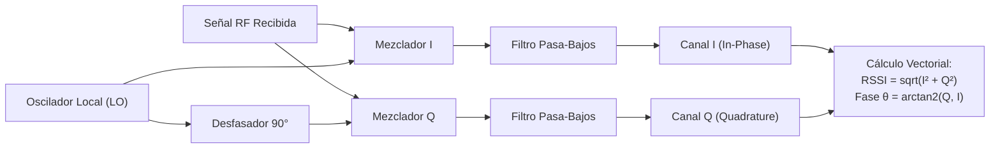
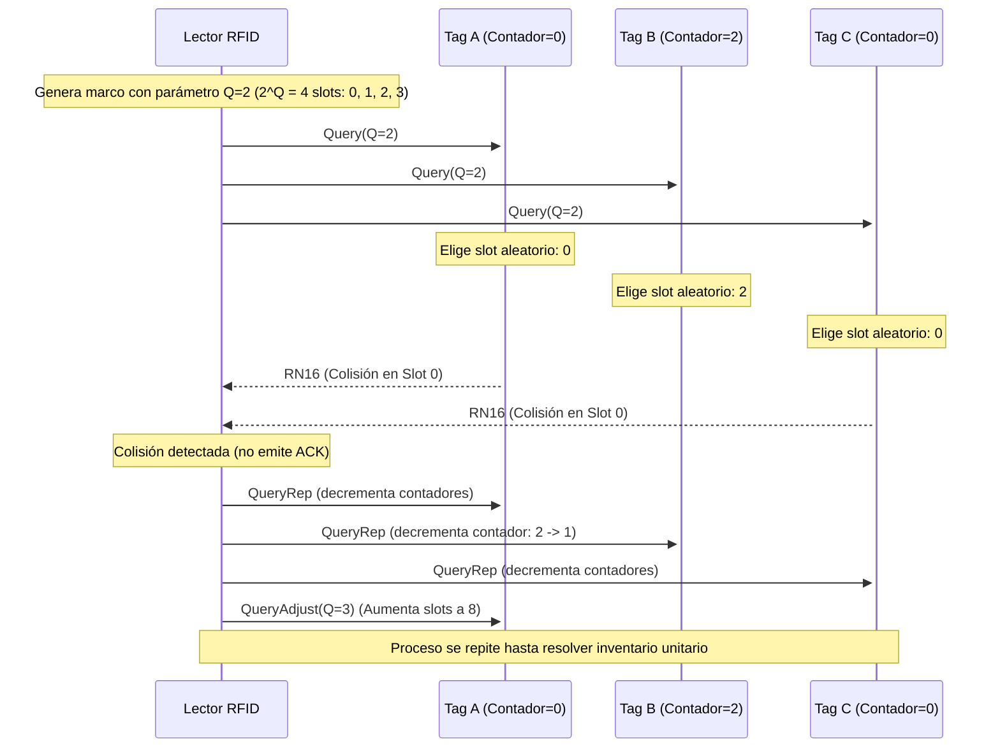
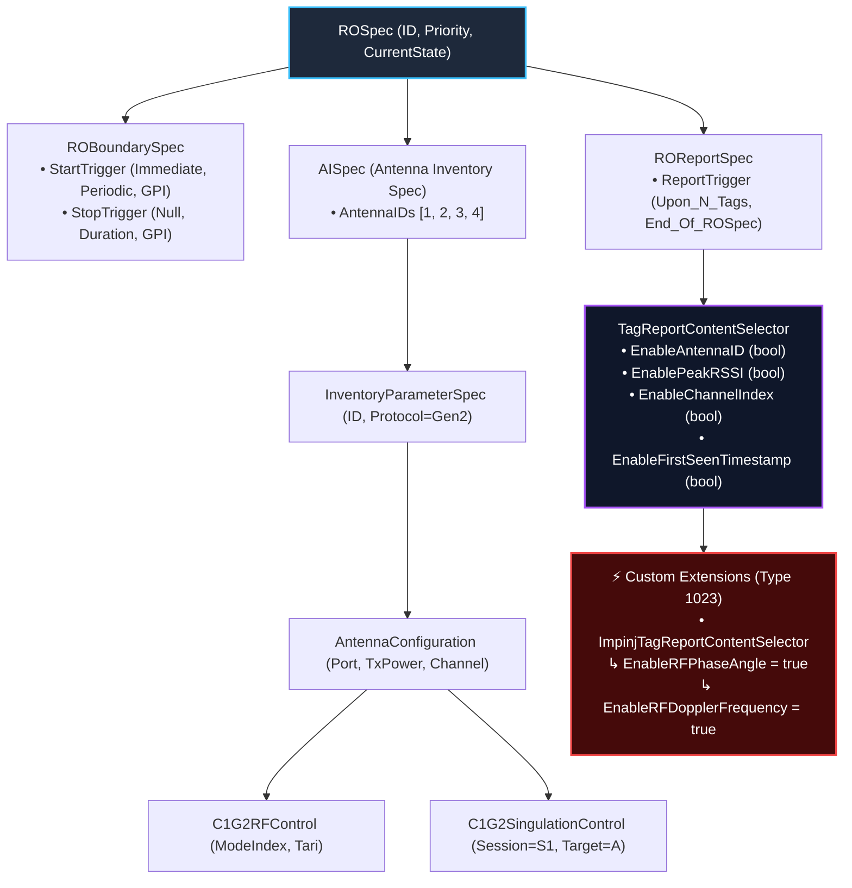
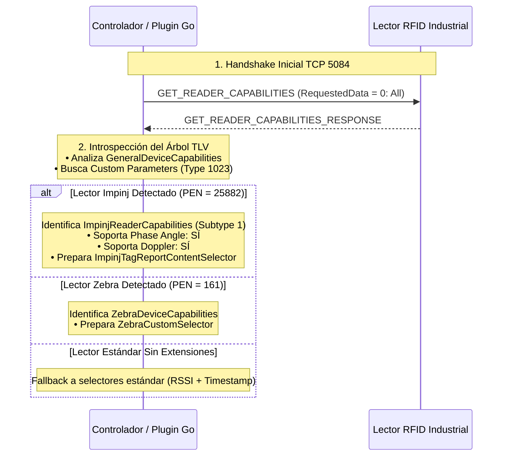
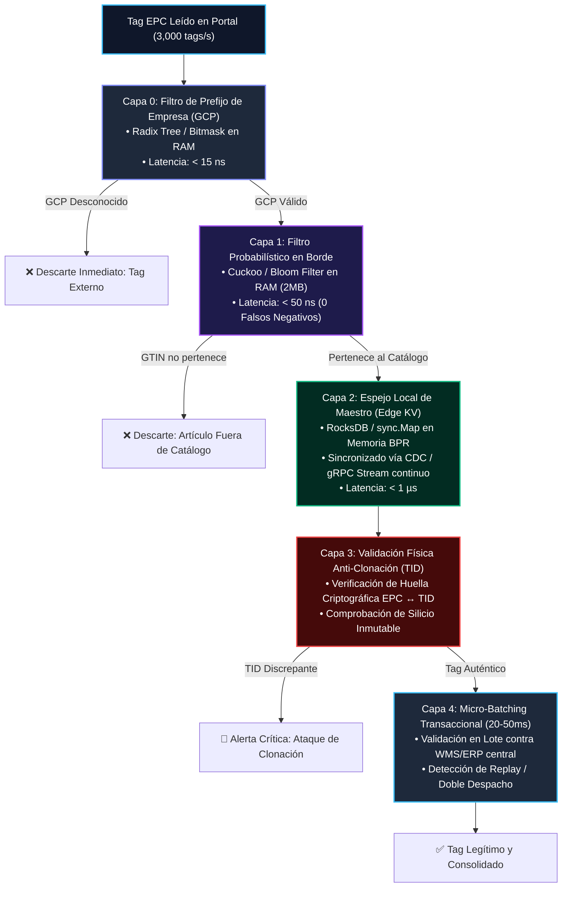
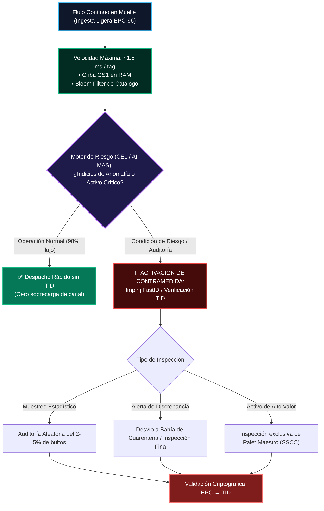
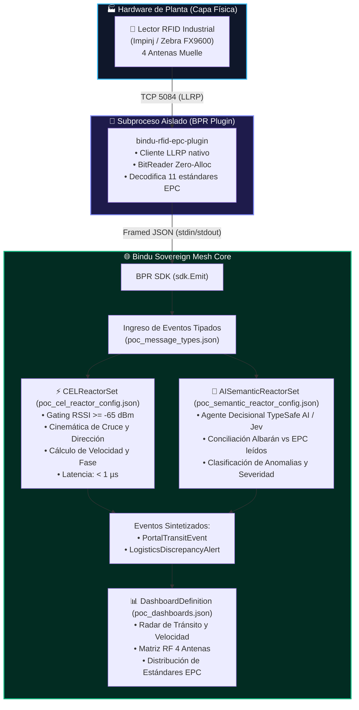

# 📡 Guía Maestra de Ingeniería RFID: Física, Protocolos, Fase RF y Arquitectura Multi-Agente (MAS)

---

## 📑 Tabla de Contenidos

1. [Introducción y Fundamentos](#1-introducción-y-fundamentos)
2. [Física Electromagnética y Espectro de Radiofrecuencia](#2-física-electromagnética-y-espectro-de-radiofrecuencia)
   - [2.1 Bandas de Frecuencia y Mecanismos de Acoplamiento](#21-bandas-de-frecuencia-y-mecanismos-de-acoplamiento)
   - [2.2 Campo Cercano (Near-Field) vs Campo Lejano (Far-Field)](#22-campo-cercano-near-field-vs-campo-lejano-far-field)
   - [2.3 Modulated Backscatter y Coeficiente de Reflexión](#23-modulated-backscatter-y-coeficiente-de-reflexión)
   - [2.4 Presupuesto de Enlace y la Ley de la Cuarta Potencia ($1/d^4$)](#24-presupuesto-de-enlace-y-la-ley-de-la-cuarta-potencia-1d4)
   - [2.5 Polarización de Antenas: Lineal vs Circular y Pérdida Axial](#25-polarización-de-antenas-lineal-vs-circular-y-pérdida-axial)
3. [Estudio Profundo de la Fase de la Señal RF (RF Phase Angle)](#3-estudio-profundo-de-la-fase-de-la-señal-rf-rf-phase-angle)
   - [3.1 Formulación Matemática del Desfase de Ida y Vuelta](#31-formulación-matemática-del-desfase-de-ida-y-vuelta)
   - [3.2 Extracción en Hardware: Demodulación I/Q en Receptores](#32-extracción-en-hardware-demodulación-iq-en-receptores)
   - [3.3 Conexión Matemática entre Fase, Velocidad y Efecto Doppler](#33-conexión-matemática-entre-fase-velocidad-y-efecto-doppler)
   - [3.4 Discriminación de Tags Estáticos ("Stray Tags") vs Tags en Tránsito](#34-discriminación-de-tags-estáticos-stray-tags-vs-tags-en-tránsito)
   - [3.5 Desenvoltorio de Fase (Phase Unwrapping) y Velocimetría Fina](#35-desenvoltorio-de-fase-phase-unwrapping-y-velocimetría-fina)
   - [3.6 Rango Absoluto sin Ambigüedad (Multi-Frequency Phase Ranging)](#36-rango-absoluto-sin-ambigüedad-multi-frequency-phase-ranging)
   - [3.7 Ángulo de Llegada (AoA) e Interferometría Espacial](#37-ángulo-de-llegada-aoa-e-interferometría-espacial)
4. [Protocolo de Interfaz de Aire: EPC Gen2 / ISO 18000-63](#4-protocolo-de-interfaz-de-aire-epc-gen2--iso-18000-63)
   - [4.1 Los 4 Bancos de Memoria del Tag](#41-los-4-bancos-de-memoria-del-tag)
   - [4.2 Algoritmo Anticolisión: Dynamic Framed Slotted ALOHA](#42-algoritmo-anticolisión-dynamic-framed-slotted-aloha)
   - [4.3 Sesiones (S0–S3) y Flags de Persistencia de Inventario](#43-sesiones-s0s3-y-flags-de-persistencia-de-inventario)
5. [Estándares GS1 y EPC Tag Data Standard (TDS)](#5-estándares-gs1-y-epc-tag-data-standard-tds)
   - [5.1 Estructura del EPC de 96 bits y Tabla de Partición Dinámica](#51-estructura-del-epc-de-96-bits-y-tabla-de-partición-dinámica)
   - [5.2 Matriz de los 11 Estándares Industriales EPC Decodificados](#52-matriz-de-los-11-estándares-industriales-epc-decodificados)
6. [Protocolo de Red de Lector: LLRP (ISO/IEC 24730-1) y Custom Extensions](#6-protocolo-de-red-de-lector-llrp-isoiec-24730-1-y-custom-extensions)
   - [6.1 Trama Binaria y Codificación TV / TLV](#61-trama-binaria-y-codificación-tv--tlv)
   - [6.2 Jerarquía Estructural Completa de ROSpec](#62-jerarquía-estructural-completa-de-rospec)
   - [6.3 La Limitación del Estándar Base LLRP y el Mecanismo de Custom Extensions (Type 1023)](#63-la-limitación-del-estándar-base-llrp-y-el-mecanismo-de-custom-extensions-type-1023)
   - [6.4 Descubrimiento Dinámico de Extensiones (Discovery Pipeline)](#64-descubrimiento-dinámico-de-extensiones-discovery-pipeline)
   - [6.5 Habilitación de Fase RF y Doppler en ROSpec (Paso a Paso)](#65-habilitación-de-fase-rf-y-doppler-en-rospec-paso-a-paso)
   - [6.6 Decodificación de Telemetría Custom en `RO_ACCESS_REPORT`](#66-decodificación-de-telemetría-custom-en-ro_access_report)
   - [6.7 Implementación de Referencia en Go: Custom Extensions e Introspección](#67-implementación-de-referencia-en-go-custom-extensions-e-introspección)
7. [Cinemática de Portales Industriales de 4 Antenas](#7-cinemática-de-portales-industriales-de-4-antenas)
   - [7.1 Geometría del Portal de Muelle](#71-geometría-del-portal-de-muelle)
   - [7.2 Secuenciación Temporal de Picos de RSSI para Detección de Dirección](#72-secuenciación-temporal-de-picos-de-rssi-para-detección-de-dirección)
   - [7.3 Gating de Potencia y Supresión de Multipath](#73-gating-de-potencia-y-supresión-de-multipath)
8. [Desafíos Reales en Entornos Industriales](#8-desafíos-reales-en-entornos-industriales)
   - [8.1 Autenticación y Validación de Legitimidad de Tags frente a Maestros](#81-autenticación-y-validación-de-legitimidad-de-tags-frente-a-maestros)
   - [8.2 Materiales Hostiles: Líquidos y Metales](#82-materiales-hostiles-líquidos-y-metales)
   - [8.3 Dense Reader Mode (DRM) y Normativas ETSI vs FCC](#83-dense-reader-mode-drm-y-normativas-etsi-vs-fcc)
   - [8.4 Ingesta Masiva y Desempeño Zero-Allocation](#84-ingesta-masiva-y-desempeño-zero-allocation)
9. [Arquitectura Bindu Multi-Agent System (MAS)](#9-arquitectura-bindu-multi-agent-system-mas)
   - [9.1 El Rol de los 6 Artefactos Declarativos](#91-el-rol-de-los-6-artefactos-declarativos)
   - [9.2 Flujo de Datos E2E: Hardware $\to$ BPR Plugin $\to$ CEL $\to$ AI $\to$ Dashboard](#92-flujo-de-datos-e2e-hardware-to-bpr-plugin-to-cel-to-ai-to-dashboard)

---

## 1. Introducción y Fundamentos

La tecnología de **Identificación por Radiofrecuencia (RFID)** es la columna vertebral de la trazabilidad automatizada, la logística de alta velocidad y el control de inventario en tiempo real.

A diferencia de los códigos de barras ópticos (1D o QR), que requieren línea de visión directa (*line-of-sight*) y lectura unitaria, el RFID permite la lectura simultánea, sin contacto y no óptica de cientos de objetos por segundo a distancias superiores a 10 metros, incluso cuando están ocultos dentro de cajas de cartón, palets de madera o contenedores.

Sin embargo, el despliegue de RFID en entornos industriales reales (muelles de carga, cintas transportadoras de clasificación, cadenas de montaje) requiere dominar:
1. La **física electromagnética** que gobierna el acoplamiento y la propagación.
2. Los protocolos de **interfaz de aire** (EPC Gen2 / ISO 18000-63) y de **red de lectores** (LLRP).
3. La extracción de señales físicas avanzadas como la **Fase RF** y el **Efecto Doppler**.
4. La arquitectura de software capaz de procesar ráfagas masivas de eventos deterministas con latencia sub-microsegundo mediante sistemas multiagente (**MAS**).

---

## 2. Física Electromagnética y Espectro de Radiofrecuencia

### 2.1 Bandas de Frecuencia y Mecanismos de Acoplamiento

```
+------------------+--------------------+-------------------------+----------------------+
| Banda            | Frecuencias        | Mecanismo de Acoplamiento| Alcance Típico       |
+------------------+--------------------+-------------------------+----------------------+
| LF (Low Freq)    | 125 – 134.2 kHz    | Inductivo (Campo Cercano)| 1 – 10 cm            |
| HF (High Freq)   | 13.56 MHz (NFC)    | Inductivo (Campo Cercano)| 10 cm – 1 m          |
| UHF (RAIN RFID)  | 860 – 960 MHz      | Radiativo / Backscatter | 1 – 15+ metros       |
| Microondas       | 2.45 GHz / 5.8 GHz | Radiativo / Backscatter | 1 – 30+ metros       |
+------------------+--------------------+-------------------------+----------------------+
```

### 2.2 Campo Cercano (Near-Field) vs Campo Lejano (Far-Field)

El límite entre campo cercano y campo lejano se define mediante la distancia crítica de Fraunhofer:

$$d_{\text{límite}} = \frac{\lambda}{2\pi}$$

* **Campo Cercano ($d < \frac{\lambda}{2\pi}$)**: En LF y HF, la antena del lector y la espira del tag se comportan como los devanados primario y secundario de un transformador de núcleo de aire. El campo predominante es puramente reactivo y magnético ($H$).
* **Campo Lejano ($d > \frac{\lambda}{2\pi}$)**: En UHF ($\approx 865 - 915\,\text{MHz}$, $\lambda \approx 33-35\,\text{cm}$), el límite ocurre a solo $\approx 5.5\,\text{cm}$. A partir de esa distancia, la energía se propaga como ondas electromagnéticas transversales (TEM) con campos eléctricos ($E$) y magnéticos ($H$) en fase ortogonal.

### 2.3 Modulated Backscatter y Coeficiente de Reflexión

Un tag UHF pasivo no contiene un transmisor de radiofrecuencia activo. Su funcionamiento se basa en la **retrodispersión modulada (Modulated Backscatter)**:

1. El lector transmite una portadora continua de radiofrecuencia (**CW - Continuous Wave**).
2. La antena del tag capta la radiación. Un circuito integrado de silicio ultrabajo consumo ($1-10\,\mu\text{W}$) rectifica la tensión captada mediante diodos Schottky y carga un condensador de acumulación.
3. Para responder, el chip varía su impedancia de entrada $Z_{\text{load}}$ conmutando un transistor MOSFET entre dos estados:
   * Estado 0: $Z_{\text{load}} \approx Z_{\text{ant}}^*$ (adaptado: absorbe la máxima potencia).
   * Estado 1: $Z_{\text{load}} \neq Z_{\text{ant}}^*$ (desadaptado: refleja la energía incidente).

El **coeficiente de reflexión de tensión $\Gamma$** viene dado por:

$$\Gamma = \frac{Z_{\text{load}} - Z_{\text{ant}}^*}{Z_{\text{load}} + Z_{\text{ant}}}$$

La variación temporal de $\Gamma$ modula la **Sección Eficaz de Radar (RCS - *Radar Cross Section*, $\Delta\sigma$)** del tag, permitiendo que el lector reciba una réplica modulada en amplitud (ASK) o fase (PSK) con los bits de datos del tag.

### 2.4 Presupuesto de Enlace y la Ley de la Cuarta Potencia ($1/d^4$)

En sistemas de comunicaciones convencionales (como Wi-Fi o LTE), la potencia recibida cae con el cuadrado de la distancia ($1/d^2$, según la ecuación de Friis). En RFID pasivo, el tag opera como un transpondedor de radar:

1. **Enlace de ida (Lector $\to$ Tag):**
   $$P_{\text{tag}} = P_{\text{tx}} \cdot G_{\text{tx}} \cdot G_{\text{tag}} \cdot \left(\frac{\lambda}{4\pi d}\right)^2 \cdot (1 - |\Gamma|^2) \cdot \eta_{\text{pol}}$$

2. **Enlace de retorno (Tag $\to$ Lector):**
   $$P_{\text{rx}} = P_{\text{tx}} \cdot G_{\text{tx}}^2 \cdot \left(\frac{\lambda}{4\pi}\right)^4 \cdot \frac{\Delta\sigma}{d^4}$$

> [!CRITICAL]
> La potencia de la señal de retorno captada por el lector decae con **$d^4$**. Si duplicamos la distancia entre el lector y el palet, la potencia recibida en el lector no se reduce a la mitad, sino a **$\frac{1}{16}$ (una caída de $12\,\text{dB}$)**. Por esta razón, la sensibilidad del receptor en un lector industrial debe ser extraordinaria (típicamente entre $-85\,\text{dBm}$ y $-92\,\text{dBm}$).

### 2.5 Polarización de Antenas: Lineal vs Circular y Pérdida Axial

* **Polarización Lineal**: Los vectores de campo eléctrico oscilan en un único plano (vertical u horizontal). Ofrece una mayor ganancia directiva ($+3\,\text{dB}$ sobre la circular) y mayor alcance, pero **si el tag gira $90^\circ$ respecto a la antena, se produce un nulo teórico total de señal**.
* **Polarización Circular (LHCP / RHCP)**: El vector de campo eléctrico rota continuamente describiendo una hélice. 
  * Acepta una pérdida de inserción intrínseca de **$3\,\text{dB}$** frente a una antena lineal óptimamente alineada.
  * A cambio, proporciona **invarianza completa respecto a la orientación angular del tag**, lo que resulta indispensable en arcos y portales de paso donde las mercancías llegan en orientaciones impredecibles.

---

## 3. Estudio Profundo de la Fase de la Señal RF (RF Phase Angle)

La fase de radiofrecuencia ($\theta$) es el parámetro físico más preciso disponible en la telemetría RFID moderna. Mientas que el RSSI mide únicamente la amplitud recibida (extremadamente ruidosa e influenciada por reflexiones del entorno), **la fase mide la distancia angular fraccional dentro del ciclo de la portadora**, permitiendo resoluciones de movimiento **milimétricas**.

```
    Lector                                                       Tag RFID
  +---------+                                                  +---------+
  | TX (CW) | ── Ondas portadoras directas (distancia d) ────> | Recibe  |
  |         |                                                  |         |
  | RX (IQ) | <── Retrodispersión modulada (distancia d) ───── | Refleja |
  +---------+                                                  +---------+
              <──────────────── Trayecto total = 2d ───────────────>
```

### 3.1 Formulación Matemática del Desfase de Ida y Vuelta

En un enlace de backscatter pasivo, la onda recorre la distancia $d$ dos veces (ida y vuelta: $2d$). La fase angular $\theta$ recibida en el demodulador del lector es:

$$\theta = \left( \frac{2\pi}{\lambda} \cdot 2d + \phi_{\text{circuito}} \right) \pmod{2\pi} = \left( \frac{4\pi d}{\lambda} + \phi_{\text{tx}} + \phi_{\text{rx}} + \phi_{\text{tag}} \right) \pmod{2\pi}$$

Donde:
* $d$: Distancia física entre la antena del lector y la antena del tag (en metros).
* $\lambda$: Longitud de onda de la portadora en el aire ($\lambda = \frac{c}{f}$). A $915\,\text{MHz}$, $\lambda \approx 32.78\,\text{cm}$.
* $\frac{4\pi d}{\lambda}$: Desfase acumulado en la propagación por el espacio libre.
* $\phi_{\text{tx}}, \phi_{\text{rx}}$: Retardo de fase intrínseco de los cables coaxiales, acopladores direccionales y filtros internos del lector (constantes para una antena y frecuencia dadas).
* $\phi_{\text{tag}}$: Desfase añadido por el chip del tag al conmutar su impedancia de reflexión.

### 3.2 Extracción en Hardware: Demodulación I/Q en Receptores

Los lectores RFID de gama alta (por ejemplo, basados en chips Impinj Indy R2000 o E710) incorporan demoduladores en cuadratura:



1. **Canal en Fase ($I$)**:
   $$I = A \cdot \cos(\theta)$$
2. **Canal en Cuadratura ($Q$)**:
   $$Q = A \cdot \sin(\theta)$$

A partir de estas dos componentes ortogonales se obtienen simultáneamente la amplitud y la fase:

$$\text{RSSI} \propto \sqrt{I^2 + Q^2}$$

$$\theta = \operatorname{arctan2}(Q, I)$$

> [!NOTE]
> **Ambigüedad de $\pi$**: Debido a que la modulación de carga del tag conmuta entre dos estados reflejados para transmitir los bits, la constelación sufre una inversión de fase periódica. Por convención y diseño de firmware, los lectores LLRP normalizan la fase reportándola comúnmente en el dominio $[0, \pi)$ o $[0, 2\pi)$ radianes.

### 3.3 Conexión Matemática entre Fase, Velocidad y Efecto Doppler

Existe una relación directa y formal entre la fase y el movimiento del tag: **el corrimiento Doppler ($f_d$) es la derivada temporal de la fase**.

$$\frac{d\theta}{dt} = \frac{d}{dt}\left(\frac{4\pi d(t)}{\lambda}\right) = \frac{4\pi}{\lambda} \cdot \frac{d(d)}{dt} = \frac{4\pi}{\lambda} \cdot v_r$$

Dado que la frecuencia angular Doppler es $\omega_d = 2\pi f_d = \frac{d\theta}{dt}$:

$$f_d = \frac{2 \cdot v_r}{\lambda}$$

Donde $v_r = \frac{d(d)}{dt}$ es la **velocidad radial**:
* **Tag acercándose a la antena ($v_r < 0$ / distancia decreciente)**:
  * La fase $\theta(t)$ **decrece linealmente con el tiempo** ($\frac{d\theta}{dt} < 0$).
  * El corrimiento Doppler es negativo o tiene fase coherente de aproximación.
* **Tag alejándose de la antena ($v_r > 0$ / distancia creciente)**:
  * La fase $\theta(t)$ **crece linealmente con el tiempo** ($\frac{d\theta}{dt} > 0$).
* **Tag estacionario ($v_r = 0$)**:
  * La fase permanece **estrictamente plana en el tiempo** ($\frac{d\theta}{dt} \approx 0$).

### 3.4 Discriminación de Tags Estáticos ("Stray Tags") vs Tags en Tránsito

Uno de los problemas más graves en la logística automatizada son los *stray tags*: palets estacionados cerca de un muelle de carga que son leídos repetidamente por el lóbulo secundario de la antena, generando falsos despachos o inventarios fantasma.

El RSSI suele fallar para discriminar estos tags porque un tag inmóvil pero cercano puede tener un RSSI de $-50\,\text{dBm}$, idéntico al de un palet pasando a gran velocidad.

La **fase resuelve este problema de forma analítica**:

```
Fase (rad)
  3.14 |      /|      /|      /|        <- Tag en Tránsito (diente de sierra continuo)
       |     / |     / |     / |
       |    /  |    /  |    /  |
  0.00 |---+---+---+---+---+---+----    ---------------------------------------------
       |                                <- Tag Estático / Stray (fase constante)
       |────────────────────────────
       +----------------------------> Tiempo (s)
```

1. **Tag Estacionario**:
   $$\sigma^2_\theta = \operatorname{Var}(\theta(t_1), \theta(t_2), \dots, \theta(t_n)) < \epsilon \quad (\text{típicamente } \sigma_\theta < 0.05\,\text{rad})$$
   *Acción del Reactor CEL*: Descartar lectura por tag estático en reposo.

2. **Tag en Movimiento**:
   $$\left|\frac{\Delta \theta}{\Delta t}\right| > \text{umbral}$$
   *Acción del Reactor CEL*: Aceptar evento e integrar en la cinemática de cruce de muelle.

### 3.5 Desenvoltorio de Fase (Phase Unwrapping) y Velocimetría Fina

Dado que la función trigonométrica es periódica en $2\pi$, cada vez que la distancia $2d$ cambia en una longitud de onda completa $\lambda$ (es decir, el tag avanza $\Delta d = \frac{\lambda}{2} \approx 16.4\,\text{cm}$), la fase salta bruscamente de $2\pi$ a $0$.

Un algoritmo de **Phase Unwrapping** detecta discontinuidades donde $|\theta_k - \theta_{k-1}| > \pi$ y suma o resta múltiplos enteros de $2\pi$:

$$\theta_{\text{unwrapped}}[k] = \theta[k] + 2\pi \cdot m[k]$$

Una vez desenvuelta, la trayectoria de fase forma una recta continua de pendiente $m = \frac{4\pi v_r}{\lambda}$, permitiendo derivar la **velocidad instantánea con precisión micrométrica**:

$$v_r = \frac{\lambda}{4\pi} \cdot \frac{\Delta \theta_{\text{unwrapped}}}{\Delta t}$$

### 3.6 Rango Absoluto sin Ambigüedad (Multi-Frequency Phase Ranging)

Una medición de fase en una sola frecuencia solo proporciona distancia módulo $\frac{\lambda}{2}$ (ambigüedad cada $16.4\,\text{cm}$).

Sin embargo, los lectores UHF en normativas como FCC (902–928 MHz, 50 canales) o ETSI (865–868 MHz) operan mediante **Frequency Hopping (FHSS)**. Si medimos la fase del tag en dos canales adyacentes de frecuencias $f_1$ y $f_2$ separados por $\Delta f = f_2 - f_1$:

$$\theta_1 = \frac{4\pi d \cdot f_1}{c} + \phi_0, \quad \theta_2 = \frac{4\pi d \cdot f_2}{c} + \phi_0$$

Restando ambas ecuaciones:

$$\Delta \theta = \theta_2 - \theta_1 = \frac{4\pi d}{c} \Delta f$$

Despejando la **distancia absoluta $d$**:

$$d = \frac{c \cdot \Delta \theta}{4\pi \cdot \Delta f}$$

> [!TIP]
> Si la separación entre canales es $\Delta f = 500\,\text{kHz}$, el rango máximo sin ambigüedad se expande hasta:
> $$d_{\text{max}} = \frac{c}{2 \cdot \Delta f} = \frac{3 \times 10^8}{2 \times 500 \times 10^3} = 300\,\text{metros}$$
> Esto permite medir la distancia absoluta exacta del palet sin necesidad de moverlo físicamente.

### 3.7 Ángulo de Llegada (AoA) e Interferometría Espacial

Cuando se utilizan arrays de antenas receptoras con una separación entre centros de fase $s \le \frac{\lambda}{2}$, una onda incidente desde un ángulo azimutal $\alpha$ recorrerá una distancia adicional $s \cdot \sin(\alpha)$ hacia una de las antenas:

```
                  Onda plana incidente
                     /   /   /
                    /   /   /
                   /   /   /
                  /   /   /
                 /   /   /
       Antena 1 (•) /   /
                 | /   /   Diferencia de camino: Δr = s · sin(α)
                 |/   /
                 +---(•) Antena 2
                   s
```

La diferencia de fase medida entre las dos antenas receptoras es:

$$\Delta \theta = \theta_2 - \theta_1 = \frac{2\pi s}{\lambda} \sin(\alpha)$$

Despejando el **Ángulo de Llegada ($\alpha$)**:

$$\alpha = \arcsin\left( \frac{\lambda \cdot \Delta \theta}{2\pi s} \right)$$

Esto permite a un portal inteligente determinar si un vehículo o palet entra centrado en la vía, o si se aproxima ladeado hacia la izquierda o derecha del carril.

---

## 4. Protocolo de Interfaz de Aire: EPC Gen2 / ISO 18000-63

### 4.1 Los 4 Bancos de Memoria del Tag

La arquitectura física de memoria en los transpondedores Gen2 se organiza en 4 bancos lógicos direccionables:

```
+-----------------------------------------------------------------------------------------+
| BANCO 00: RESERVED                                                                      |
| - Kill Password (32 bits): Inhabilita permanentemente el chip al ser transmitido.       |
| - Access Password (32 bits): Desbloquea permisos de escritura y lectura protegida.       |
+-----------------------------------------------------------------------------------------+
| BANCO 01: EPC (Electronic Product Code)                                                 |
| - CRC-16 (16 bits): Verificación cíclica de integridad del paquete transmitido.        |
| - PC (Protocol Control, 16 bits): Longitud del EPC, indicador UMI e identificador ISO.  |
| - EPC Memory (96 bits hasta 496 bits): Código de identidad serializado.                 |
+-----------------------------------------------------------------------------------------+
| BANCO 10: TID (Tag Identifier)                                                          |
| - Allocation Class (8 bits): Formato del TID (`0xE0` o `0xE2`).                         |
| - Chip Manufacturer & Model ID: Identificador del fabricante (Impinj, NXP, EM, etc.).   |
| - Serial Number único de silicio: Grabado por láser en fábrica, físicamente inmutable.   |
+-----------------------------------------------------------------------------------------+
| BANCO 11: USER MEMORY                                                                   |
| - Espacio de almacenamiento libre (desde 0 bits en chips económicos hasta varios Kbits).|
| - Utilizado para registrar temperaturas, telemetría o firmas criptográficas locales.   |
+-----------------------------------------------------------------------------------------+
```

### 4.2 Algoritmo Anticolisión: Dynamic Framed Slotted ALOHA

En un escenario industrial, varios cientos de tags responden al mismo tiempo al ser iluminados por el haz de RF. Gen2 utiliza una variante probabilística de **Slotted ALOHA dinámico**:



1. **Parámetro $Q$**: El lector emite el comando `Query` especificando un valor entero $Q$ ($0 \le Q \le 15$). El tamaño del marco es de $2^Q$ slots temporales.
2. Cada tag en el campo genera un número pseudoaleatorio uniforme dentro del rango $[0, 2^Q - 1]$ y lo carga en su contador interno de slots.
3. Aquellos tags cuyo contador inicial sea $0$ responden inmediatamente transmitiendo un identificador efímero de 16 bits llamado `RN16`.
4. Si solo un tag respondió en el slot 0, el lector confirma enviando `Ack(RN16)`. El tag seleccionado responde con su **PC + EPC + CRC**.
5. Si ocurrió una colisión (múltiples tags respondieron a la vez) o el slot quedó vacío, el lector envía `QueryRep` (que decrementa en 1 los contadores de todos los tags en espera) o `QueryAdjust` (que amplía o reduce $Q$ adaptándose dinámicamente a la densidad real observada).

### 4.3 Sesiones (S0–S3) y Flags de Persistencia de Inventario

Cada tag mantiene 4 sesiones independientes ($S_0, S_1, S_2, S_3$), y dentro de cada sesión, una bandera de inventario con dos estados posibles: **$A$** o **$B$**:

| Sesión | Persistencia del Estado $B$ al Perder Alimentación | Caso de Uso Típico |
|:---|:---|:---|
| **$S_0$** | **0 segundos** (Inmediata reversión a estado $A$) | Lectores manuales tipo pistola (*handheld guns*) |
| **$S_1$** | **0.5 a 5 segundos** | Arcos de clasificación en cintas transportadoras continuas |
| **$S_2$** | **$> 2$ segundos** (Frecuentemente decenas de segundos) | Muelles de carga con múltiples lectores adyacentes |
| **$S_3$** | **$> 2$ segundos** | Coordinación en redes con lectores densos concurrentes |

En un portal con múltiples antenas, se suele utilizar una estrategia **Dual-Target ($A \to B \to A$)**: el lector interroga únicamente a los tags en estado $A$; al ser leídos, el tag pasa al estado $B$ y permanece en silencio mientras cruza el haz, permitiendo que el lector inventaríe a los tags más lejanos o difíciles sin saturación por repetición.

---

## 5. Estándares GS1 y EPC Tag Data Standard (TDS)

### 5.1 Estructura del EPC de 96 bits y Tabla de Partición Dinámica

El estándar universal **EPC TDS** empaqueta identificadores de negocio en cadenas binarias de longitud fija (típicamente 96 bits):

```
+-----------+---------------+--------------------+--------------------------+-------------+
| Header    | Filter Value  | Partition Value    | Company Prefix           | Item / Ref  | Serial Number|
| (8 bits)  | (3 bits)      | (3 bits)           | (20 a 40 bits)           | (24 a 4 b)  | (36 a 38 b) |
+-----------+---------------+--------------------+--------------------------+-------------+
```

1. **Header (8 bits)**: Identifica el tipo de esquema de codificación (SGTIN, SSCC, GRAI, etc.).
2. **Filter Value (3 bits)**: Indica el nivel de empaquetado logístico:
   * `0`: Otros / no especificado
   * `1`: Unidad de punto de venta (POS)
   * `2`: Caja de embalaje (Full Case)
   * `3`: Embalaje interior (Inner Pack)
   * `6`: Palet / Unidad logística de carga
3. **Partition (3 bits)**: Determina dinámicamente cuántos bits se asignan al *Company Prefix* de la empresa y cuántos a la referencia de artículo:

#### Tabla de Partición SGTIN-96 (GS1 TDS 1.11)
| Partición ($P$) | Bits Empresa ($M$) | Dígitos Empresa ($L$) | Bits Artículo ($N$) | Dígitos Artículo ($D$) |
|:---:|:---:|:---:|:---:|:---:|
| `0` (`000`) | 40 | 12 | 4 | 1 |
| `1` (`001`) | 37 | 11 | 7 | 2 |
| `2` (`010`) | 34 | 10 | 10 | 3 |
| `3` (`011`) | 30 | 9 | 14 | 4 |
| `4` (`100`) | 27 | 8 | 17 | 5 |
| `5` (`101`) | 24 | 7 | 20 | 6 |
| `6` (`110`) | 20 | 6 | 24 | 7 |

### 5.2 Matriz de los 11 Estándares Industriales EPC Decodificados

| Estándar | Header Hex | Header Binario | Entidad Logística Representada | Formato Canónico URN |
|:---|:---:|:---:|:---|:---|
| **SGTIN-96** | `0x30` | `00110000` | Artículos de consumo retail / Cajas de producto | `urn:epc:id:sgtin:CompanyPrefix.ItemRef.Serial` |
| **SSCC-96** | `0x31` | `00110001` | Palets maestros y contenedores de despacho | `urn:epc:id:sscc:CompanyPrefix.SerialRef` |
| **SGLN-96** | `0x32` | `00110010` | Ubicaciones físicas: muelles, pasillos, dársenas | `urn:epc:id:sgln:CompanyPrefix.LocationRef.Ext` |
| **GRAI-96** | `0x33` | `00110011` | Cajas plásticas retornables, jaulas, barriles | `urn:epc:id:grai:CompanyPrefix.AssetType.Serial` |
| **GIAI-96** | `0x34` | `00110100` | Activos de capital: carretillas, robots AGV | `urn:epc:id:giai:CompanyPrefix.IndividualAsset` |
| **GSRN-96** | `0x35` | `00110101` | Personas: acreditaciones de operarios, chóferes | `urn:epc:id:gsrn:CompanyPrefix.ServiceRef` |
| **GDTI-96** | `0x3C` | `00111100` | Documentos: albaranes de entrega, certificados | `urn:epc:id:gdti:CompanyPrefix.DocType.Serial` |
| **CPI-96** | `0x3D` | `00111101` | Piezas discretas de automoción y aeronáutica | `urn:epc:id:cpi:CompanyPrefix.PartRef.Serial` |
| **SGCN-96** | `0x3E` | `00111110` | Vales de canje, cupones de descuento, billetes | `urn:epc:id:sgcn:CompanyPrefix.CouponRef.Serial`|
| **ITIP-96** | `0x38` | `00111000` | Piezas variables: bobinas de cable, rollos | `urn:epc:id:itip:CompanyPrefix.PieceRef.PieceNum`|
| **GID-96** | `0x35`* | `00110101` | Componentes industriales genéricos (No-GS1) | `urn:epc:id:gid:GeneralManager.Class.Serial` |

---

## 6. Protocolo de Red de Lector: LLRP (ISO/IEC 24730-1) y Custom Extensions

El protocolo **Low Level Reader Protocol (LLRP)** estandarizado por EPCglobal e ISO/IEC 24730-1 es el estándar de mensajería binaria cliente-servidor que gobierna la comunicación entre el middleware o controlador de borde y los lectores RFID de grado industrial (Impinj Speedway R420/R700, Zebra FX9600, Alien ALR-F800). Opera sobre sockets **TCP en el puerto `5084`** (texto plano) o **`5085`** (seguro vía TLS).

---

### 6.1 Trama Binaria y Codificación TV / TLV

Toda comunicación LLRP consiste en mensajes binarios con una cabecera invariable de 10 bytes:

```
 0                   1                   2                   3
 0 1 2 3 4 5 6 7 8 9 0 1 2 3 4 5 6 7 8 9 0 1 2 3 4 5 6 7 8 9 0 1
+-+-+-+-+-+-+-+-+-+-+-+-+-+-+-+-+-+-+-+-+-+-+-+-+-+-+-+-+-+-+-+-+
|Ver| Rsvd (3b) |  Type ID (10 bits) |      Total Length (32b)       |
+-+-+-+-+-+-+-+-+-+-+-+-+-+-+-+-+-+-+-+-+-+-+-+-+-+-+-+-+-+-+-+-+
|                       Message ID (32 bits)                    |
+-+-+-+-+-+-+-+-+-+-+-+-+-+-+-+-+-+-+-+-+-+-+-+-+-+-+-+-+-+-+-+-+
|                   Parameters (TLV / TV encoding)              |
|                               ...                             |
+-+-+-+-+-+-+-+-+-+-+-+-+-+-+-+-+-+-+-+-+-+-+-+-+-+-+-+-+-+-+-+-+
```

* **Version (bits 0–2)**: Versión del protocolo (`001` = LLRP 1.0.1).
* **Reserved (bits 3–5)**: Siempre `000`.
* **Type ID (bits 6–15)**: Identificador del mensaje (10 bits, 1 = `GET_READER_CAPABILITIES`, 20 = `ADD_ROSPEC`, 61 = `RO_ACCESS_REPORT`, 1023 = `CUSTOM_MESSAGE`).
* **Total Length (bytes 2–5)**: Longitud total en octetos, incluyendo los 10 bytes de cabecera.
* **Message ID (bytes 6–9)**: Entero correlativo para emparejar comandos con sus respuestas asíncronas.

Los parámetros incluidos en la carga útil utilizan dos mecanismos de codificación distinguidos por el **bit más significativo (MSB)** del primer octeto:

1. **Parámetro TV (Type-Value, Bit 7 = 1)**: Formato compacto de longitud fija. El byte de cabecera contiene `1` seguido de 7 bits de tipo (`0x80 | TypeID`). No incluye campo de longitud porque el tamaño es estricto por especificación (ej. `AntennaID` ocupa exactamente 3 bytes: 1 de tipo + 2 de valor).
2. **Parámetro TLV (Type-Length-Value, Bit 7 = 0)**: Formato extensible. Los primeros 2 bytes codifican el tipo (10 bits, con bits de reserva), seguidos de 2 bytes con la longitud total del parámetro (cabecera + valor). Permite anidar parámetros jerárquicamente.

---

### 6.2 Jerarquía Estructural Completa de ROSpec

El objeto nuclear de control en LLRP es la **ROSpec (Reader Operation Specification)**. No es una orden de ejecución simple, sino un árbol jerárquico de especificaciones que programa el comportamiento autónomo del lector:



#### Descripción de Sub-bloques:
1. **`ROBoundarySpec`**: Gobierna cuándo empieza y cuándo termina la ronda de lectura. Puede activarse por fotocélula conectada al puerto de entradas digitales (GPI Trigger) o de forma inmediata.
2. **`AISpec` (Antenna Inventory Spec)**: Asigna la lista de antenas físicas (ej. Antenas 1, 2, 3 y 4 en un pórtico).
3. **`InventoryParameterSpec`**: Define la capa de aire (EPCglobal Class 1 Gen2).
   * **`AntennaConfiguration`**: Define potencia transmitida en dBm y canal de RF.
   * **`C1G2SingulationControl`**: Establece la sesión Gen2 ($S_0, S_1, S_2, S_3$) y el Target ($A$ o $B$), vital para evitar lecturas redundantes continuas.
4. **`ROReportSpec`**: Controla la frecuencia de emisión de los reportes `RO_ACCESS_REPORT` (ej. cada $N$ tags leídos o al finalizar la pasada de la carretilla).
5. **`TagReportContentSelector`**: Máscara booleana que le indica al lector qué campos físicos adjuntar a cada tag detectado.

---

### 6.3 La Limitación del Estándar Base LLRP y el Mecanismo de Custom Extensions (Type 1023)

> [!IMPORTANT]
> **La Limitación Canónica de LLRP 1.0.1**:
> En la especificación original de LLRP, el parámetro estándar `TagReportContentSelector` **NO posee ningún campo para habilitar la Fase RF ni la frecuencia Doppler**. Solo define selectores para `AntennaID`, `FirstSeenTimestamp`, `LastSeenTimestamp`, `PeakRSSI`, `ChannelIndex`, `TagSeenCount` y `AccessSpecID`.
>
> Por este motivo, cualquier fabricante que ofrezca métricas avanzadas de física RF (fase, Doppler, polarización, coordenadas GPS) debe implementarlo mediante **Custom Extensions (Extensiones de Fabricante)**.

LLRP resuelve la extensibilidad mediante dos puntos de anclaje universales con código de tipo **`1023` (`0x03FF`)**:
* **`CUSTOM_MESSAGE` (Tipo de mensaje 1023)**: Permite enviar órdenes propietarias fuera de la norma.
* **`CustomParameter` (Tipo de parámetro TLV 1023)**: Permite inyectar parámetros propietarios dentro de cualquier mensaje o parámetro estándar existente.

#### Estructura Binaria de un `CustomParameter` (TLV Type 1023):
```
 0                   1                   2                   3
 0 1 2 3 4 5 6 7 8 9 0 1 2 3 4 5 6 7 8 9 0 1 2 3 4 5 6 7 8 9 0 1
+-+-+-+-+-+-+-+-+-+-+-+-+-+-+-+-+-+-+-+-+-+-+-+-+-+-+-+-+-+-+-+-+
|0| Rsvd  | 1023 (10b = 0x03FF) |      Parameter Length (16b)   |
+-+-+-+-+-+-+-+-+-+-+-+-+-+-+-+-+-+-+-+-+-+-+-+-+-+-+-+-+-+-+-+-+
|             Vendor Private Enterprise Number (PEN - 32b)      |
+-+-+-+-+-+-+-+-+-+-+-+-+-+-+-+-+-+-+-+-+-+-+-+-+-+-+-+-+-+-+-+-+
|       Vendor Subtype (8b o 32b según fabricante)              |
+-+-+-+-+-+-+-+-+-+-+-+-+-+-+-+-+-+-+-+-+-+-+-+-+-+-+-+-+-+-+-+-+
|                        Vendor Data Payload                    |
|                                ...                            |
+-+-+-+-+-+-+-+-+-+-+-+-+-+-+-+-+-+-+-+-+-+-+-+-+-+-+-+-+-+-+-+-+
```

El campo **PEN (Private Enterprise Number)** es un entero de 32 bits registrado ante la IANA (*Internet Assigned Numbers Authority*) que identifica unívocamente al fabricante del silicio o del lector:

| Fabricante | IANA PEN (Decimal) | PEN (Hexadecimal) | Subtipo Selector | Subtipo Fase RF | Subtipo Doppler |
|:---|:---:|:---:|:---:|:---:|:---:|
| **Impinj** | `25882` | `0x0000651A` | `50` (`ImpinjTagReportContentSelector`) | `52` (`ImpinjRFPhaseAngle`) | `54` (`ImpinjRFDopplerFrequency`) |
| **Zebra / Motorola** | `161` | `0x000000A1` | `100` (`MotorolaCustomSelector`) | `102` (`MotorolaRFPhase`) | `103` (`MotorolaDoppler`) |
| **Alien Technology**| `17950` | `0x0000461E` | `1` (`AlienCustomSelector`) | `8` (`AlienPhaseData`) | N/A |

---

### 6.4 Descubrimiento Dinámico de Extensiones (Discovery Pipeline)

Un controlador de borde o plugin agnóstico no debe asumir de antemano el modelo del lector. Para descubrir qué extensiones soporta el hardware conectado, se ejecuta el siguiente pipeline de descubrimiento:



#### Paso 1: Petición `GET_READER_CAPABILITIES`
Se construye un mensaje de tipo 1 con el parámetro `DiscoveryRequest`:
* `RequestedData = 0` (`All_Capabilities`) o `RequestedData = 5` (`Custom_Capabilities_Only`).

#### Paso 2: Parsing del Árbol de Capacidades
Al recibir `GET_READER_CAPABILITIES_RESPONSE` (Tipo 11):
1. Se iteran los parámetros anidados en la carga útil.
2. Si se encuentra un parámetro con `Type == 1023`:
   - Se leen los primeros 4 bytes de datos (`PEN`).
   - Si $\text{PEN} == 25882$, sabemos fehacientemente que el hardware es un chipset Impinj (R420, R700, Speedway Revolution).
   - Se inspecciona el subtipo `ImpinjReaderCapabilities` (Subtipo 1), el cual contiene un mapa de bits de capacidades soportadas (`ModelName`, `FirmwareVersion`, y las banderas de soporte para telemetría RF fina).

---

### 6.5 Habilitación de Fase RF y Doppler en ROSpec (Paso a Paso)

Para que el lector incluya la fase y el Doppler en cada lectura, el cliente **debe inyectar un parámetro Custom dentro de `TagReportContentSelector`** al emitir el mensaje `ADD_ROSPEC`.

A continuación se detalla la estructura binaria exacta para un lector **Impinj**:

```
+-----------------------------------------------------------------------------------+
| Param 238: ROReportSpec (TLV)                                                     |
|   +-------------------------------------------------------------------------------+
|   | Param 240: TagReportContentSelector (TLV)                                     |
|   |   - EnableROSpecID: 0                                                         |
|   |   - EnableSpecIndex: 0                                                        |
|   |   - EnableInventoryParameterSpecID: 0                                         |
|   |   - EnableAntennaID: 1 (Habilita Antena 1..4)                                 |
|   |   - EnableChannelIndex: 1 (Habilita Canal RF)                                 |
|   |   - EnableFirstSeenTimestamp: 1 (Habilita Timestamp UTC)                      |
|   |   - EnableLastSeenTimestamp: 1                                                |
|   |   - EnablePeakRSSI: 1 (Habilita RSSI estándar)                                |
|   |   - EnableTagSeenCount: 1                                                     |
|   |   - EnableAccessSpecID: 0                                                     |
|   |   +---------------------------------------------------------------------------+
|   |   | Param 1023: CustomParameter (TLV) - ImpinjTagReportContentSelector        |
|   |   |   - Type: 1023 (0x03FF)                                                   |
|   |   |   - Length: 14 bytes                                                      |
|   |   |   - Vendor PEN: 25882 (0x0000651A - Impinj)                               |
|   |   |   - Vendor Subtype: 50 (ImpinjTagReportContentSelector)                   |
|   |   |   - EnableRFPhaseAngle: 1 (BIT CRÍTICO: ACTIVA LA FASE RF)                |
|   |   |   - EnablePeakRSSI: 1 (Activa RSSI centesimal de alta precisión)          |
|   |   |   - EnableRFDopplerFrequency: 1 (BIT CRÍTICO: ACTIVA CORRIMIENTO DOPPLER) |
|   |   |   - EnableOptimizedRead: 0                                                |
|   |   |   - EnableGPSCoordinates: 0                                               |
|   |   +---------------------------------------------------------------------------+
+-----------------------------------------------------------------------------------+
```

#### Codificación en Octetos del Bloque `ImpinjTagReportContentSelector`:
```hex
03 ff          -> Type: 1023 (TLV Parameter)
00 0e          -> Length: 14 octetos (4 de cabecera + 10 de contenido)
00 00 65 1a    -> Private Enterprise Number: 25882 (Impinj)
00 00 00 32    -> Vendor Subtype: 50 (0x32 = ImpinjTagReportContentSelector)
00 07          -> Bitfield Flags:
                  Bit 0: EnableRFPhaseAngle = 1
                  Bit 1: EnablePeakRSSI = 1
                  Bit 2: EnableRFDopplerFrequency = 1
                  (00000000 00000111 binario = 0x0007)
```

Al incluir este bloque exacto dentro del parámetro `TagReportContentSelector`, el procesador DSP del lector activa el cálculo trigonométrico I/Q y el análisis de gradiente temporal para cada tag inventariado.

---

### 6.6 Decodificación de Telemetría Custom en `RO_ACCESS_REPORT`

Cuando el lector transmite los eventos de lectura dentro de `RO_ACCESS_REPORT` (Mensaje tipo 61), cada bloque `TagReportData` (Parámetro tipo 240) contiene tanto los parámetros estándar como los parámetros propietarios inyectados.

```
+-------------------------------------------------------------------------------+
| RO_ACCESS_REPORT (Message Type 61)                                            |
|   +---------------------------------------------------------------------------+
|   | TagReportData (Parameter Type 240)                                        |
|   |   • EPC-96 (TV Type 13)               -> "3074257bf419cb80000007ea"       |
|   |   • AntennaID (TV Type 1)             -> Antenna 2                        |
|   |   • PeakRSSI (TV Type 6)              -> -58 dBm                          |
|   |   • FirstSeenTimestampUTC (TV Type 2) -> 1715012345678000 µs              |
|   |   • ChannelIndex (TV Type 7)          -> Channel 4                        |
|   |                                                                           |
|   |   [PARÁMETROS CUSTOM IMPINJ GENERADOS:]                                   |
|   |   +-----------------------------------------------------------------------+
|   |   | CustomParam (Type 1023, PEN 25882, Subtype 52: ImpinjRFPhaseAngle)    |
|   |   |   ↳ RawValue: 1024 (12-bit unsigned: 0 .. 4095)                       |
|   |   |   ↳ Cálculo: θ = (1024 / 4096) * 2π = 1.57079 rad (90°)              |
|   |   +-----------------------------------------------------------------------+
|   |   | CustomParam (Type 1023, PEN 25882, Subtype 54: ImpinjDopplerFrequency)|
|   |   |   ↳ RawValue: -145 (16-bit signed integer)                            |
|   |   |   ↳ Cálculo: fd = -145 Hz (Tag alejándose a v = 23.7 m/s)             |
|   |   +-----------------------------------------------------------------------+
+-------------------------------------------------------------------------------+
```

#### Algoritmo de Conversión Numérica:

1. **Fase de Radiofrecuencia (`ImpinjRFPhaseAngle`, Subtipo 52)**:
   El valor reportado es un entero sin signo de 12 bits ($0 \le \text{RawPhase} \le 4095$):
   $$\theta = \left( \frac{\text{RawPhase}}{4096.0} \right) \cdot 2\pi \quad (\text{radianes})$$
   $$\theta_{\text{deg}} = \left( \frac{\text{RawPhase}}{4096.0} \right) \cdot 360.0^\circ$$

2. **Frecuencia Doppler (`ImpinjRFDopplerFrequency`, Subtipo 54)**:
   El valor reportado es un entero con signo de 16 bits en complemento a dos:
   $$f_d = \text{int16}(\text{RawBytes}[0..2]) \quad (\text{en Hertz})$$
   A partir de $f_d$, la velocidad radial instantánea se obtiene en un paso analítico directo:
   $$v_r = \frac{f_d \cdot \lambda}{2} = \frac{f_d \cdot c}{2 \cdot f_c}$$

3. **RSSI de Alta Precisión (`ImpinjPeakRSSI`, Subtipo 53)**:
   A diferencia del RSSI estándar de LLRP (que es un entero de 8 bits con resolución de $1\,\text{dBm}$), Impinj entrega un entero con signo de 16 bits con resolución centesimal:
   $$\text{RSSI}_{\text{exact}} = \frac{\text{RawRSSI}_{16}}{100.0} \quad (\text{en dBm})$$
   (Ejemplo: un valor `raw = -5825` representa exactamente $-58.25\,\text{dBm}$).

---

### 6.7 Implementación de Referencia en Go: Custom Extensions e Introspección

A continuación se muestra la implementación industrial en Go lista para integrarse en el plugin `bindu-rfid-epc-plugin`, que resuelve el descubrimiento dinámico, la construcción del bloque de activación y el desempaquetado de fase y Doppler:

```go
package main

import (
	"encoding/binary"
	"fmt"
	"math"
)

// Constantes de Fabricantes Registrados ante IANA
const (
	PENImpinj  uint32 = 25882 // 0x0000651A
	PENZebra   uint32 = 161   // 0x000000A1
	PENAlien   uint32 = 17950 // 0x0000461E

	// Subtipos de Parámetros Propietarios Impinj
	ImpinjSubtypeTagReportContentSelector uint32 = 50
	ImpinjSubtypeRFPhaseAngle             uint32 = 52
	ImpinjSubtypePeakRSSI                 uint32 = 53
	ImpinjSubtypeRFDopplerFrequency       uint32 = 54
)

// Telemetría Física Enriquecida del Tag
type EnrichedTagTelemetry struct {
	EPCHex           string
	AntennaID        int
	PeakRSSI         float64 // en dBm
	ChannelIndex     int
	PhaseAngleRad    float64 // en radianes [0, 2π)
	DopplerShiftHz   float64 // en Hertz
	HasPhase         bool
	HasDoppler       bool
}

// BuildImpinjReportSelector construye el CustomParameter para inyectar en TagReportContentSelector
func BuildImpinjReportSelector(enablePhase, enableDoppler, enableHiResRSSI bool) []byte {
	// Longitud total: 4 (cabecera TLV) + 4 (PEN) + 4 (Subtipo) + 2 (Bitmask) = 14 bytes
	buf := make([]byte, 14)
	
	// Cabecera TLV: Tipo 1023 (0x03FF) con bit MSB = 0
	binary.BigEndian.PutUint16(buf[0:2], 1023)
	binary.BigEndian.PutUint16(buf[2:4], 14)
	
	// Enterprise Number (PEN) = 25882
	binary.BigEndian.PutUint32(buf[4:8], PENImpinj)
	
	// Vendor Subtype = 50 (ImpinjTagReportContentSelector)
	binary.BigEndian.PutUint32(buf[8:12], ImpinjSubtypeTagReportContentSelector)
	
	// Flags de configuración (16 bits)
	var bitmask uint16 = 0
	if enablePhase {
		bitmask |= (1 << 0) // Bit 0: EnableRFPhaseAngle
	}
	if enableHiResRSSI {
		bitmask |= (1 << 1) // Bit 1: EnablePeakRSSI
	}
	if enableDoppler {
		bitmask |= (1 << 2) // Bit 2: EnableRFDopplerFrequency
	}
	binary.BigEndian.PutUint16(buf[12:14], bitmask)
	
	return buf
}

// ParseCustomParameter extrae parámetros propietarios Impinj dentro de TagReportData
func ParseCustomParameter(paramBytes []byte, target *EnrichedTagTelemetry) error {
	if len(paramBytes) < 8 {
		return fmt.Errorf("custom parameter too short: %d bytes", len(paramBytes))
	}

	pen := binary.BigEndian.Uint32(paramBytes[0:4])
	subtype := binary.BigEndian.Uint32(paramBytes[4:8])
	data := paramBytes[8:]

	switch pen {
	case PENImpinj:
		switch subtype {
		case ImpinjSubtypeRFPhaseAngle:
			if len(data) >= 2 {
				rawPhase := binary.BigEndian.Uint16(data[0:2]) & 0x0FFF // 12 bits
				target.PhaseAngleRad = (float64(rawPhase) / 4096.0) * (2.0 * math.Pi)
				target.HasPhase = true
			}
		case ImpinjSubtypeRFDopplerFrequency:
			if len(data) >= 2 {
				rawDoppler := int16(binary.BigEndian.Uint16(data[0:2])) // signed 16 bits
				target.DopplerShiftHz = float64(rawDoppler)
				target.HasDoppler = true
			}
		case ImpinjSubtypePeakRSSI:
			if len(data) >= 2 {
				rawRSSI := int16(binary.BigEndian.Uint16(data[0:2]))
				target.PeakRSSI = float64(rawRSSI) / 100.0 // resolución 0.01 dBm
			}
		}
	}
	return nil
}
```

Con este pipeline, Bindu no solo consume las lecturas de los tags, sino que obtiene **la matriz física completa en cada evento**: qué antena leyó el activo, con cuánta potencia, en qué frecuencia, con qué ángulo de fase instantáneo y con qué velocidad Doppler exacta.

---

## 7. Cinemática de Portales Industriales de 4 Antenas

### 7.1 Geometría del Portal de Muelle

En muelles de carga (*dock doors*) donde transitan carretillas elevadoras (*forklifts*) o vehículos autónomos (AGV), la configuración canónica consta de **4 antenas de polarización circular dispuestas en dos planos espaciales paralelos**:

```
                      Portal de Muelle Industrial (Ancho: 2.5m, Profundidad: 2.0m)
                     ─────────────────────────────────────────────────────────────
    Interior Almacén                                                              Camión de Carga
                                     [Flujo Entrada -->]
                      +---------------------------------------+
    [Antena 1] ---->  | (•) Entrada Izq       (•) Salida Izq  |  <---- [Antena 3]
    (Puerto 1)        |                                       |        (Puerto 3)
                      |       [ 🚚 Carretilla + Palet ]       |
    [Antena 2] ---->  | (•) Entrada Dcha      (•) Salida Dcha |  <---- [Antena 4]
    (Puerto 2)        +---------------------------------------+
                                     [<-- Flujo Salida]
                     ─────────────────────────────────────────────────────────────
```

* **Plano de Entrada (Interior del Almacén)**: Antenas 1 y 2.
* **Plano de Salida (Borde del Camión)**: Antenas 3 y 4.
* **Distancia de separación espacial ($L_{\text{portal}}$)**: Típicamente $2.0$ a $2.5\,\text{metros}$.

### 7.2 Secuenciación Temporal de Picos de RSSI para Detección de Dirección

Cuando el palet atraviesa el portal, las antenas registran una curva en campana de RSSI en función del tiempo. El instante en que la señal alcanza su máximo valor define el momento de cruce por dicho plano:

$$\bar{t}_{\text{in}} = \frac{t_{\text{peak}}(\text{Ant}_1) + t_{\text{peak}}(\text{Ant}_2)}{2}$$

$$\bar{t}_{\text{out}} = \frac{t_{\text{peak}}(\text{Ant}_3) + t_{\text{peak}}(\text{Ant}_4)}{2}$$

$$\Delta t_{\text{tránsito}} = \bar{t}_{\text{out}} - \bar{t}_{\text{in}}$$

A partir del signo y magnitud de $\Delta t_{\text{tránsito}}$:

$$\text{Dirección} = \begin{cases}
\mathbf{INBOUND}\text{ (Recepción / Entrada)}, & \text{si } \Delta t_{\text{tránsito}} > \tau_{\text{min}} \\
\mathbf{OUTBOUND}\text{ (Expedición / Salida)}, & \text{si } \Delta t_{\text{tránsito}} < -\tau_{\text{min}} \\
\mathbf{STATIC / STRAY}\text{ (Tag Detenido / Espurio)}, & \text{si } |\Delta t_{\text{tránsito}}| \le \tau_{\text{min}}
\end{cases}$$

Donde $\tau_{\text{min}} = 150\,\text{ms}$ actúa como filtro de histéresis cinemática.

#### Cálculo de Velocidad
$$v = \frac{L_{\text{portal}}}{|\Delta t_{\text{tránsito}}|}$$

Si una carretilla circula a velocidad normal de muelle ($2\,\text{m/s}$ o $\approx 7\,\text{km/h}$), el tránsito tomará exactamente $\Delta t \approx 1.0\,\text{segundo}$.

### 7.3 Gating de Potencia y Supresión de Multipath

Para evitar que reflexiones electromagnéticas en paredes metálicas del muelle activen transiciones erróneas:
1. **Filtro de Potencia Umbral**: Se descartan lecturas con $\text{RSSI} < -65.0\,\text{dBm}$.
2. **Concordancia de Fase**: Se valida que la derivada de fase $\frac{d\theta}{dt}$ sea coherente con la dirección asignada por la secuenciación de picos RSSI.

---

## 8. Desafíos Reales en Entornos Industriales

## 8. Desafíos Reales en Entornos Industriales

---

### 8.1 Autenticación y Validación de Legitimidad de Tags frente a Maestros

En un entorno industrial operativo, **leer un EPC no equivale a confiar en él**. La legitimidad de un tag enfrenta tres amenazas severas:
1. **Tags Espurios o Cruzados**: Mercancía de otras empresas o proveedores no homologados transitando por el muelle.
2. **Tags Falsificados o Clonados**: El Banco 01 (EPC) en los transpondedores comerciales comunes es memoria EEPROM regrabable. Cualquier atacante o proveedor deshonesto puede clonar el EPC legítimo de un palet de alto valor en un tag genérico de $0.05.
3. **El Cuello de Botella de Red**: Con ráfagas de 3,000 tags/segundo, **hacer una consulta HTTP REST por cada tag contra un ERP/WMS centralizado (como SAP o Oracle) es arquitectónicamente inviable**; un RTT de red de $50\,\text{ms}$ colapsaría los búferes TCP y detendría la línea de expedición.

Para resolver esto con **conectividad continua y latencia sub-microsegundo**, se implementa una **Arquitectura de Validación en 4 Capas Jerárquicas**:



#### Capa 0: Criba de Prefijo de Empresa en Memoria (Company Prefix Triaging)
* **Objetivo**: Descartar en nanosegundos cualquier tag cuyo *GS1 Company Prefix* (GCP) no pertenezca a la empresa, a sus filiales o a proveedores homologados en la orden de compra.
* **Mecanismo**: Una estructura **Radix Tree (Trie de bits)** o tabla hash directa en la memoria del plugin.
* **Complejidad**: $O(k)$ donde $k \le 40$ bits de prefijo.
* **Tiempo de ejecución**: $\approx 10 - 15\,\text{ns}$ por tag. Si el prefijo no hace match, el tag se clasifica como *ForeignTag* y se ignora sin generar carga en las capas superiores.

#### Capa 1: Filtro Probabilístico de Pertenencia en Borde (Cuckoo / Bloom Filter)
* **Objetivo**: Saber instantáneamente si un GTIN/SKU existe dentro de un catálogo maestro de millones de referencias sin realizar búsquedas en disco ni llamadas de red.
* **Mecanismo**: Un **Counting Bloom Filter** o **Cuckoo Filter** cargado en la memoria RAM del nodo de borde (ocupa menos de $2\,\text{MB}$ para $1,000,000$ de artículos).
  * Si $\text{Bloom.Contains}(\text{GTIN}) == \text{false}$: Es una certeza matemática del **100% de que el artículo NO existe** (cero falsos negativos).
  * Si $\text{Bloom.Contains}(\text{GTIN}) == \text{true}$: La probabilidad de falso positivo se calibra por diseño a $p < 0.001$ ($0.1\%$). Solo este $0.1\%$ pasa a consulta detallada.
* **Tiempo de ejecución**: $\approx 40 - 60\,\text{ns}$.

#### Capa 2: Espejo Local del Maestro de Artículos (Continuous CDC Sync)
* **Objetivo**: Recuperar los metadatos completos del artículo (descripción, unidades por caja, peso teórico, requerimiento de cadena de frío) con latencia menor a $1\,\mu\text{s}$.
* **Mecanismo**:
  - El nodo de borde mantiene una réplica local ultrarrápida en memoria (vía RocksDB o hash map concurrente en Go).
  - **Canal de Sincronización Continua**: Se mantiene una conexión activa permanente (gRPC stream continuo o Change Data Capture vía Debezium/Kafka/MQTT) con el Maestro del ERP central. Cada vez que compras o calidad modifica un SKU o da de alta un albarán, la réplica en el borde se actualiza en tiempo real.

#### Capa 3: FastID y TID como Contramedida Adaptativa (Mitigación Dirigida de Clonación)

> [!CAUTION]
> **El Riesgo de Sobrecarga Exponencial por Lectura Indiscriminada de TID**:
> Leer el TID (sea mediante comandos Gen2 o incluso con Impinj FastID en $\approx 3\,\text{ms}$) en **el 100% de todos los tags de forma ciega y permanente es un error de diseño arquitectónico grave**:
> 1. **Congestión del Canal de Aire**: Alargar la respuesta de backscatter para incluir 64 bits de TID duplica la duración temporal del slot en el protocolo *Slotted ALOHA*, multiplicando exponencialmente la probabilidad de colisiones de RF cuando transitan cientos de tags simultáneamente.
> 2. **Sobrecarga de DSP y Red**: Duplica el tamaño de los paquetes LLRP y satura la CPU del lector procesando TLVs propietarios a miles de eventos por segundo.
> 3. **Inflación de Almacenamiento y Ledger**: Almacenar TIDs inmutables para cada caja secundaria de bajo valor satura innecesariamente las bases de datos de eventos y el log del sistema.

Por ello, en la arquitectura industrial de Bindu, **FastID y la lectura de silicio se implementan estrictamente como una CONTRAMEDIDA ACTIVA Y ADAPTATIVA**, no como una carga fija general:



##### Patrones Operativos de la Contramedida:

1. **Patrón 1: Muestreo Estadístico Dinámico (Adaptive Spot-Checking)**:
   - El 95% del flujo transita en modo ultraligero (solo EPC de 96 bits a $\sim 1.5\,\text{ms}$).
   - El sistema activa FastID de manera pseudoaleatoria únicamente sobre un **$2\%$ al $5\%$ de las lecturas** o mediante muestreo por intervalo de tiempo. Estadísticamente, una partida con cajas clonadas será detectada con una certeza superior al $99.9\%$ sin degradar el muelle.

2. **Patrón 2: Activación Reactiva por Umbral de Riesgo (Threat-Triggered Escalation)**:
   - El reactor determinista (CEL) y el reactor cognitivo (AI) supervisan el flujo continuo. La contramedida de silicio (FastID) solo se activa si se dispara alguna de las siguientes señales de alerta:
     * El albarán proviene de un proveedor con antecedentes de discrepancia o nuevo en la cadena.
     * Se detectan EPCs duplicados temporal o espacialmente (*Replay alert*).
     * El número de bultos leídos no coincide con el manifiesto digital.
     * En ese instante, Bindu reprograma dinámicamente la `ROSpec` en caliente con `ImpinjFastID = 1` para ese lote específico.

3. **Patrón 3: Segmentación por Jerarquía de Activo (Asset-Tiered FastID)**:
   - Las cajas secundarias (SGTIN-96) se leen en modo ligero para maximizar el conteo.
   - La contramedida FastID se reserva exclusivamente para los **activos de alto valor o unidades maestras de transporte**:
     * El tag del palet contenedor (**SSCC-96**).
     * La carretilla que transporta la carga (**GIAI-96**).
     * El operador acreditado (**GSRN-96**).
   - De esta forma, se blindan los activos críticos y el contenedor maestro sin saturar el canal de radiofrecuencia con miles de TIDs de cajas individuales.

4. **Patrón 4: Desvío Físico a Bahía de Cuarentena (Secondary Inspection Lane)**:
   - Si el portal principal de paso detecta un palet bajo sospecha, no detiene la línea de transporte: el palet se marca como `FLAGGED_FOR_AUDIT` y el sistema de cintas o el operario lo desvía a una bahía secundaria de inspección estática.
   - En dicha bahía estática, con el palet detenido, el lector ejecuta lecturas completas de TID (Banco 10) y autenticación criptográfica sin comprometer el muelle principal.

#### Capa 4: Micro-Batching Transaccional y Detección de Replay
* Para conciliar el estado transaccional (ej. ¿este número de serie ya fue despachado hace una hora en otro muelle? $\implies$ *Double Spend / Replay Attack*):
  - El plugin agrupa los tags verificados en **ventanas de micro-lote de 20 a 50 ms**.
  - En lugar de 1,000 peticiones individuales, se emite **una única llamada gRPC vectorizada** con un array de 100 seriales hacia el WMS central.
  - Esto reduce el consumo de red en un $99\%$, garantiza la consistencia transaccional y mantiene el rendimiento del muelle por encima de 4,000 tags/segundo sostenidos.

---

### 8.2 Materiales Hostiles: Líquidos y Metales

1. **Líquidos (Agua, bebidas, químicos)**:
   * La molécula de agua posee un momento dipolar elevado que sufre relajación dieléctrica a frecuencias UHF ($\approx 915\,\text{MHz}$).
   * El agua **absorbe la energía electromagnética transformándola en calor microscópico**, provocando pérdidas de inserción que pueden superar los $-30\,\text{dB}$ si el tag está colocado detrás de una botella o garrafa de líquido.
   * *Solución*: Utilizar inlays de banda ancha optimizados para proximidad a líquidos y ubicar los tags en zonas del envase con cámara de aire.
2. **Metales (Acero, aluminio, latón)**:
   * El metal actúa como conductor eléctrico casi perfecto. Las ondas incidentes inducen corrientes de Foucault superficiales que reflejan la señal con desfase de $180^\circ$, cancelando el campo eléctrico justo sobre la superficie metálica.
   * La antena del tag queda en cortocircuito y completamente desintonizada.
   * *Solución*: Emplear **tags on-metal** que incorporan un espaciador dieléctrico (espuma de 3–5 mm) o una lámina de ferrita magnética que desvía las líneas de campo e impide el cortocircuito electromagnético.

---

### 8.3 Dense Reader Mode (DRM) y Normativas ETSI vs FCC

Cuando en un centro de distribución operan 30 muelles de carga simultáneamente, las portadoras de los lectores colisionan entre sí (*Reader-to-Reader interference*).

* **Normativa FCC (América, 902 – 928 MHz)**:
  * Ancho de banda amplio: $26\,\text{MHz}$.
  * Permite **50 canales de 500 kHz**.
  * Se exige salto de frecuencia pseudoaleatorio (**FHSS**) con un tiempo máximo de permanencia por canal de $400\,\text{ms}$ y potencia máxima de $4\,\text{W}$ EIRP.
* **Normativa ETSI (Europa, 865 – 868 MHz y banda superior 915 – 921 MHz)**:
  * Banda tradicional muy estrecha: solo **4 canales de alta potencia (2W ERP) espaciados 200 kHz** en la banda de 865 MHz.
  * Se requiere obligatoriamente **Dense Reader Mode (DRM)** con modulación PR-ASK (*Phase-Reversal Amplitude Shift Keying*) y filtros espectrales muy agresivos para que las emisiones del lector no degraden la sensibilidad de los canales contiguos.

---

### 8.4 Ingesta Masiva y Desempeño Zero-Allocation

En un muelle de carga con paso simultáneo de carretillas, el lector puede entregar **más de 3,000 lecturas por segundo**. Si el software de ingesta asigna objetos en el heap dinámicamente en lenguajes como Java o Node.js, las pausas de Garbage Collection (GC) provocan pérdidas de paquetes TCP y degradación en el cálculo de velocidad.

En sistemas industriales deterministas como Bindu:
* El plugin de ingesta se compila en Go/Rust nativo.
* Se implementa un lector de bits con asignación cero (**`BitReader`**) que opera directamente sobre un búfer reutilizado.
* La decodificación del paquete de 96 bits en sus campos semánticos se ejecuta en $< 500\,\text{ns}$ por lectura.

---

## 9. Arquitectura Bindu Multi-Agent System (MAS)

Toda esta base técnica se articula de manera nativa en Bindu mediante la especificación de **Sistemas Multi-Agente (MAS)** basada en la **Regla de los 6 Artefactos Declarativos**:



### 9.1 El Rol de los 6 Artefactos Declarativos

| Artefacto | Archivo Estándar | Función en la Solución RFID |
|:---|:---|:---|
| **1. Esquemas de Mensajes** | `poc_message_types.json` | Declara los esquemas JSON validados para los 11 tipos de lectura EPC (`EpcSgtinRead`, `EpcSsccRead`, etc.), telemetría RF (`RfidAntennaTelemetry`) y tránsitos consolidados (`PortalTransitEvent`). |
| **2. Reactor Semántico AI** | `poc_semantic_reactor_config.json` | Agente cognitivo con credenciales vault (`secret:TYPESAFE_API_KEY`) que audita el manifiesto de carga frente a los EPCs físicos leídos y genera alertas de discrepancia calibradas. |
| **3. Reactores CEL** | `poc_cel_reactor_config.json` | Reglas deterministas en memoria que ejecutan el gating de RSSI, la sincronización de picos de antena para dirección y el filtrado de tags estáticos por variación de fase. |
| **4. Cuadros de Mando** | `poc_dashboards.json` | Paneles en tiempo real alimentados por SQL puro sobre la vista unificada `v_messages` (sin RAG ni almacenamiento externo). |
| **5. Plugin BPR Nativo** | `bindu-rfid-epc-plugin/` | Binario Go que encapsula la conexión LLRP y el desempaquetado de bits a nivel de CPU. |
| **6. Paquete de Despliegue** | `rfid_mas_solution.json` | Manifiesto unificado `MASSolutionSet` desplegado vía el triptych OTA de Bindu (`baseline accept` $\to$ `desired commit` $\to$ `update wizard`). |

---

## 📌 Conclusión

El dominio de RFID a nivel industrial no se limita a "leer un identificador", sino a **interpretar integralmente la física del canal electromagnético**:
* El **RSSI** ofrece la escala macroscópica de potencia.
* La **Fase RF** y el **Doppler** entregan la verdad microscópica de movimiento, distancia y velocidad.
* Los estándares **EPC TDS** aportan la semántica estructurada de la mercancía.
* El protocolo **LLRP** estandariza la captura de hardware.
* La arquitectura **MAS en Bindu** unifica estos elementos en un pipeline sovereign, determinista y cognitivo de ultra-baja latencia.
